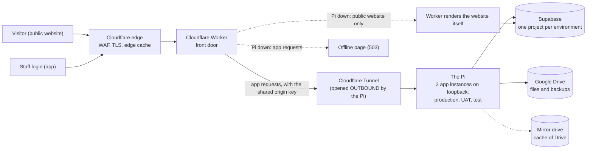
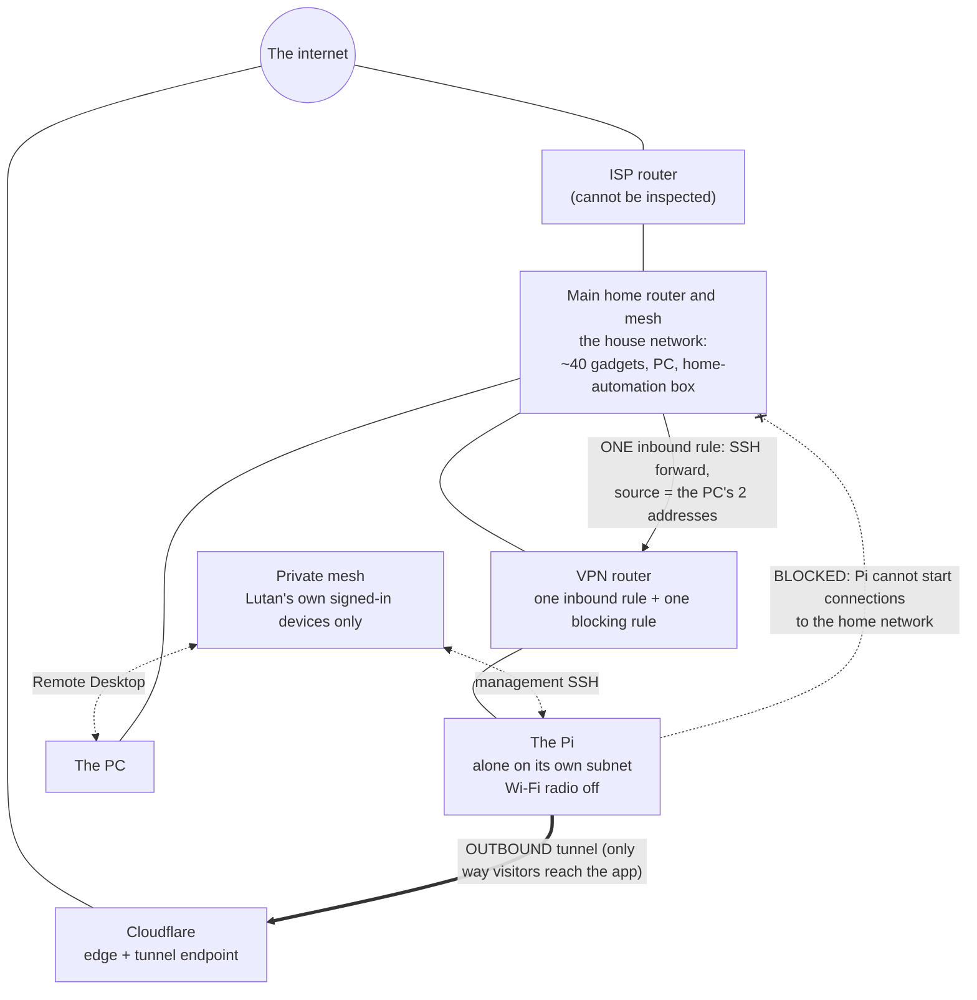

# As-built: the hardware and the technology stack, as of 2026-11-13

**What this is.** One document that says what the shelter's system physically and logically *is*, with
the security measures gathered where a reader can see them together. It is dated in its filename on
purpose. An as-built is wrong the day the hardware changes; this one says what was true on its date and
names how each section was read, so it stays useful after that instead of silently becoming untrue.
Backlog item `#s54mf`; asked for by Lutan on 2026-11-12.

**What this is not.** It is not `docs/architecture-review-2026-09-22.md`, which is a findings review of
the code (what is wrong and what to change). This records what exists. It is also not live: re-read a
line against its source before relying on it for anything that matters.

## How to read the marks

Every security statement carries one of three marks, then the date and how it was read.

| Mark | Meaning |
|---|---|
| **IN PLACE** | The control exists today and a reading of it was taken. |
| **INTENDED, NOT BUILT** | Decided or bought-for, but not running. Never read this as protection. |
| **NOT ESTABLISHED** | Nobody has read it, or the reading was inconclusive. Said so rather than guessed. |

A document that writes an intended control down as present is worse than none. When this item was filed,
all three of its headline controls were described as open; two had been done that same day. That is why
the marks are the deliverable.

## What is deliberately not in this document

This repository is public and git keeps every version (`#1wf15`,
`docs/decisions/2026-11-01-hardware-identifiers-in-a-public-repo.md`). So the **meaning** is here and the
**value** is not: no IP address, MAC, serial, device model, Wi-Fi or network name, tunnel id, account id,
or the port numbers that form a lock. Counts are given instead of tables. Where an example is needed, a
placeholder (`192.0.2.x`, `<the PC's address>`) stands in. Section 9 says where the values live.

## Contents

1. The hardware
2. Hosting and failover
3. The technology stack
4. The data stores
5. The Google identities
6. Email
7. The network and the ways in
8. The assistant's model path
9. Security measures, gathered
10. Where the values live

---

## 1. The hardware

*How read:* `docs/pi-hosting.md` (read 2026-11-13), `docs/pi-failover.md`, the Pi test results of
2026-11-01 and the home-network notes of 2026-10-24 and 2026-11-01 (Desktop; section 10). The Pi's
own state was **not** re-read for this document: the one fact taken from it, the tunnel's ingress
rules, was read on 2026-11-12.

Everything is in one house. There is no second site.

| Thing | What it is for | State |
|---|---|---|
| **The Pi** (a Raspberry Pi single-board computer) | Renders the staff app and the public website for all three environments, runs the tunnel's connector, takes the nightly database backup, keeps the Drive mirror. Alone on its own small network; Wi-Fi radio disabled. | In place |
| **Its fast drive** (NVMe) | The Pi boots and runs from it. | In place |
| **Its spare boot drive** (USB SSD) | A weekly clone of the boot drive. Boot-tested 2026-11-01 with the fast drive physically removed: it came up and served the site. | In place |
| **The mirror drive** (large USB drive, encrypted partition) | A cache of the Drive tree. Drive stays the source of truth. The partition comes back *locked* after a power cut, by decision, so the nightly job fails visibly rather than the key sitting unlocked on disk. | In place |
| **The VPN router** | Sits between the Pi and the rest of the house. Holds the rules in section 7. | In place |
| **The main home router and its mesh** | The house network everything else lives on. Its firmware is old. The ISP's own router sits in front of it and cannot be inspected. | In place |
| **A PoE switch** | Carries the Pi's cable. **Port isolation on this switch was the cause of the 2026-10-31 outage** (ports could reach the uplink but not each other); it is now off. | In place |
| **The PC** (Windows) | Lutan's workstation. Holds the production secrets and runs the Claude sessions. Reached remotely only over the private mesh (section 7). BitLocker is on. | In place |
| **A home-automation box** | Polls the app's health feed (`docs/home-assistant-monitoring.md`). It lives on the main network, not behind the VPN router. | In place |
| **A battery (UPS) for the Pi and its network path** | Chosen, specs in hand, waiting on a sale. | **INTENDED, NOT BUILT** (`#gvnrr`). Today a power cut takes the Pi down; the measured outage on 2026-11-01 was 55.6 seconds, with about 20 seconds from power back to serving. |
| **A machine to run the assistant's model** | Lutan's own computer, across the home network. | **INTENDED, NOT BUILT** (`#z04wr`): confirmed on 2026-11-10 that the machine does not exist yet. |

Outage expectation recorded by Lutan on 2026-10-26: power cuts about once every six months, never
longer than about two hours.

## 2. Hosting and failover

*How read:* `docs/pi-hosting.md`, `docs/pi-failover.md`, `scripts/pi/cloudflared-config.yml`,
`wrangler.jsonc` (all 2026-11-13), the power-pull drill of 2026-11-01, and
`docs/decisions/2026-11-12-worker-serves-the-website-not-the-app.md`.

**The path.** A visitor or staff member reaches the Cloudflare edge. A Cloudflare Worker is the front
door. For the staff app it forwards to the Pi through an **outbound** tunnel the Pi opens to Cloudflare,
so nothing is opened inward for visitors. The Pi renders and talks to Supabase and Drive. For anonymous
public pages the Worker first tries an edge cache (about ten minutes).

**When the Pi is down (changed 2026-11-12, #dxjz2).** The Worker now serves **only the public website**
and **refuses the staff app with a small self-contained offline page** (English and Thai, no external
request). Before this the Worker tried to render the app itself and was killed by Cloudflare's CPU
limit; the drill showed 113 of 180 saves reaching nothing. A write that provably never reached the Pi
gets the offline page; a write that may have reached it keeps the "check whether your change was saved"
answer, because the Pi may have acted. Every response carries an `x-lanna-served-by` header naming who
answered.

**Marks for this section**

- Tunnel is outbound-only, and the app listens on the Pi's loopback address only: **IN PLACE**
  (read from the tunnel config 2026-11-12 and the listening-sockets reading of 2026-11-07).
- Worker-serves-website-not-app: **IN PLACE in the repo; NOT LIVE on production.** The decision file
  says it ships with the next Worker deploy, which is Lutan's. Re-read the deployed Worker before
  relying on it.
- The public website is still locked on production, so today only the home page benefits; the change is
  built for go-live (same decision file).
- **NOT ESTABLISHED:** where the Worker's CPU ceiling really is, and whether production behaves as test
  did (the drill ran on test). The website path is built to degrade, not to be guaranteed. The next free
  step, if it bites, is serving the website from the edge cache.
- Recovery numbers, measured 2026-11-01: boot from the USB clone works (**IN PLACE**); a retried save
  cannot write twice because each save carries its own request id (**IN PLACE**, zero duplicates in 240
  attempts). Not an in-place control: the Pi's clock restarts from a stale time after a power cut, so
  early log timestamps after one are wrong.

## 3. The technology stack

*How read:* `README.md`, `wrangler.jsonc`, `scripts/pi/setup.sh`, `docs/pi-hosting.md` (2026-11-13).

| Layer | What | Runs where |
|---|---|---|
| The app | Next.js (a version with breaking changes from the one most people know; read `node_modules/next/dist/docs/` before changing it) | On the Pi as a long-running server, three separate instances, one per environment, each from its own clone and its own system user |
| The front door | A Cloudflare Worker, one per environment, plus a bundled copy of the app used only for the public website when the Pi is down | Cloudflare |
| The database and sign-in | Supabase (Postgres, Auth, row-level security) | Supabase, hosted in Mumbai |
| Files | Google Drive, written through the app's own Desktop OAuth client | Google |
| Mail | Two senders; see section 6 | Cloudflare and Resend |
| Machine translation | Cloudflare's Workers AI binding, a 15-minute scheduled job on test and production | Cloudflare |
| Monitoring | A scheduled health check every 15 minutes on the Worker; a read-only health feed for the home-automation box | Cloudflare and the Pi |

**Environments, by what each is for.** *Production* is the live shelter. *UAT* is the customer's
acceptance testing (live at its own address since 2026-11-08, with its own database, its own Pi
instance and its own Drive bucket). *Test* is the developers' environment on the **dev database**, which
is disposable. A deploy of production or UAT is guarded: it refuses when release notes are unreleased,
the version is not the newest release, the database lacks a migration the commit carries, or the commit
is not on `origin/main`. Test is unguarded.

**One Pi instance never carries another's secrets.** The test instance holds the dev database only and
refuses to run if a production or UAT values file is in its folder; UAT holds only UAT's; the
production folder refuses a `.env.local`. These are checks in `deploy-pi.sh`, not conventions.

## 4. The data stores

*How read:* `docs/pi-hosting.md`, `docs/decisions/2026-11-07-drive-buckets.md`,
`docs/uat-finalisation.md`, `README.md` (2026-11-13). No production read was made for this document.

**Three Supabase projects**, none listed by id here:

| Project | For | Notes |
|---|---|---|
| Production | The live shelter's records | Own sign-in client; own mail key. Daily encrypted backup (section 9). |
| UAT | The customer's acceptance testing | Separate project on a second Supabase account; its own sign-in client and mail key since 2026-11-08. |
| Dev | Test and development | Disposable. Wiped before the real migration. |

**One Google Drive account, three buckets.** Since 2026-11-07 each environment writes into its own
folder tree inside the one Drive: a Production root, a UAT root and a Test root. The tree holds
residents, photos, documents, blood work, procedures and archive PDFs; backups sit in their own
`Backups` folder. **NOT ESTABLISHED here:** how widely the Drive tree is shared today. That is the
subject of the Drive lock-down stream, a separate piece of work; take its figures from its record, not
from this document.

**The Pi's own storage.** The encrypted nightly database dumps (14 days kept; never the newest five),
the encrypted mirror partition, a photo cache per environment, and the spare boot clone. The
production database is **not** on the Pi; the dumps are the one exception, and are readable only as
ciphertext.

---

## 5. The Google identities

*How read:* `docs/google-cloud-inventory.md`, a live console stocktake dated **2026-10-09**, plus its
later entries for UAT (2026-11-08). **No Google console was opened for this document**, so anything
changed in the console after those dates is not here.

**Google accounts.** Lutan's own account and a second account owned by the shelter's foundation (the
"lanna" account) each own one Cloud project. The shelter's own mailbox account is not signed in on the
workstation and was not checked. Console access to the foundation account requires two-step
verification (Google enforces it; it locked the account out of the console from 2026-10-03 to
2026-10-09 until switched on).

**Cloud projects.**

| Project | Used for |
|---|---|
| *Lanna Care - Dev* (foundation account) | **Everything live.** Holds all four clients below. Consent screen is *In production* and brand-verified, which is what stops refresh tokens dying after seven days. |
| *LCA App* (Lutan's account) | **Nothing since 2026-10-09.** Both its clients were deleted; the project itself is still to be deleted. |
| *My First Project* (Lutan's account) | Nothing; empty. |

**OAuth clients, by purpose** (identify a client by its redirect target, never by its name):

| Client | Type | What it is for |
|---|---|---|
| Production sign-in | Web | Staff sign-in on the production Supabase project. Configured inside Supabase, not in the app's environment, so rotating it needs no deploy and signs nobody out. |
| UAT sign-in | Web | Staff sign-in on the UAT Supabase project (created 2026-11-08). |
| Dev/test sign-in | Web | Staff sign-in on the dev Supabase project. |
| Drive access | Desktop | **All Drive access for every environment**: photos, attachments, archive PDFs, backups. Four settings in the app's environment (client id, secret, a refresh token minted for one account, the tree's root folder), copied to the Worker secrets, the dev machine and the Pi. |

Production and dev/test sign-in are different clients, so rotating one cannot break the other.

**Marks for this section**

- Staff sign-in is Google only, through Supabase Auth: **IN PLACE** (inventory, 2026-10-09; UAT added
  2026-11-08).
- One Drive client and one refresh token serve every environment and the backups: **IN PLACE, and a
  known weakness.** The app's token can also delete backups. A separate identity for the backup job
  was planned and **has not been confirmed built**: on 2026-10-13 the Pi's backup line was set, by
  Lutan's decision, to use the app's own token. **INTENDED, NOT BUILT** unless a later record says
  otherwise; **NOT ESTABLISHED** whether it has changed since.
- **NOT ESTABLISHED:** a 90-day expiry noted on the backlog on 2026-09-22 (breakage expected about
  2026-12-21) was never located in any console. It is a known unknown, not a clean bill.

## 6. Email

*How read:* `docs/email-sending.md` (2026-09-23, with notes added to 2026-11-08) and `wrangler.jsonc`
(2026-11-13). No mail was sent and no dashboard opened for this document.

| Mail | To whom | Sender | Cost |
|---|---|---|---|
| Release notes on a **major** release | The environment's admins | Cloudflare's email binding on the Worker. A free account may only mail addresses it has verified, which is fine for a handful of admins. | Nil |
| Password reset | Anyone with a login | Supabase Auth, through Resend's SMTP on the sending subdomain of the shelter's domain. One key per Supabase project so either can be revoked alone. | Nil |
| Status alerts | The admins | A second Cloudflare mail binding on the Worker, separate from the release one. | Nil |

**Receiving.** The shelter's domain forwards inbound mail through Cloudflare Email Routing's catch-all to
one Gmail inbox. It is receive-only: nothing in the system sends *as* that inbox.

**Marks.** The two senders sit on subdomains so neither touches the root mail records: **IN PLACE**
(read from the runbook, 2026-09-23). **NOT ESTABLISHED:** whether the domain has a DMARC record; none
existed when read on 2026-09-23 and the runbook calls adding one optional. Release mail goes to the
sender's own verified address only; other admins are unverified on purpose.

## 7. The network and the ways in

*How read:* the four Desktop files named in section 10: the 2026-10-31 session notes, the 2026-11-01
test results, the 2026-11-07 remote-access report (with its 2026-11-10 and 2026-11-12 additions) and the
2026-10-24/11-01 network notes, plus the tunnel's ingress rules read on the Pi on 2026-11-12. Nothing
was re-read on the router or the Pi for this document. **Values are in those files and not here.**

### The layout, in meanings

- **The Pi is alone on its own small subnet behind the VPN router**, with its Wi-Fi radio disabled. With
  Wi-Fi on, a reply to an SSH request left by the other interface, around the router, and the PC dropped
  it (found 2026-11-01). Wi-Fi off is therefore part of the design, not a tidy-up.
- **The VPN router allows the Pi out** to the internet (for the tunnel, updates and the mesh).
- **An access rule on the router blocks the Pi from starting connections to the home network.** It
  matches new connections only, so replies are allowed and SSH in still works. Tested 2026-11-01 by
  binding the *source address* (testing by interface name leaves by another path and gives a false
  result).
- **The Pi's subnet is not reachable from the home network** except through the one rule below.
- **The only inbound rule is a single SSH port forward**, on a non-standard outside port, **accepting the
  PC's two addresses only** (cable and Wi-Fi; both, so one cable fault cannot lock the only way in).
  That is **one** inbound rule.
- **The router sits behind the main home router**, which sees only the router's outward-facing side.
  (A router takes consecutive hardware addresses, one per interface, so a reservation made against the
  inside one does nothing. This cost a correction on 2026-11-01.)

### What listens on the Pi, counted

| Where | Count | What |
|---|---|---|
| Its network address | **1** | SSH only |
| Its private-mesh address | **1** | The mesh provider's file-sending helper. Every peer is denied sending, so a send is refused; the port itself cannot be closed short of turning the mesh off, and the mesh is a way in. |
| Its loopback address | **4** | The three app instances and the tunnel connector's own status port. Nothing outside the Pi can reach loopback. |

### The tunnel

`/etc/cloudflared/config.yml`, read 2026-11-12: **three HTTP ingress rules**, each to one local app
instance (production, test, UAT), **and a catch-all that answers 404. No SSH, no TCP and no remote-desktop
service is exposed through the tunnel.** The tunnel is outbound; the only things that can come *in*
through it are web requests for those three hostnames, and each hostname is behind a Cloudflare rule that
blocks any request without the shared origin key, which the Pi also checks itself.

### SSH on the Pi: both halves

- `sshd` **accepts a password**, on the standard port, **from every address** (read with `sudo`,
  2026-11-12). **Root is key-only**, which is the good answer and must not be "fixed".
- **What makes the first half safe:** the only route to that SSH port from the home side is the
  source-restricted forward on a private subnet, and the mesh path is limited to Lutan's own signed-in
  devices. So a password that works is a local convenience, not an exposure. A reader given only the
  first half would reach for keys-only; that was considered and is not needed.

### The ways in, all of them

| Way in | Who | Route | Mark |
|---|---|---|---|
| The public website | Anyone | Cloudflare edge, Worker (section 2) | IN PLACE |
| The staff app | Staff logins | Cloudflare edge, Worker, tunnel, Pi | IN PLACE |
| Management SSH, at home | Lutan, from the PC | The router's one forward, from the PC's two addresses | IN PLACE (tested 2026-11-01 and 2026-11-07) |
| Management SSH, anywhere | Lutan | The private mesh (NordVPN Meshnet; the VPN itself stays disconnected, so no browsing is re-routed) | IN PLACE; tested from the PC at home only |
| The PC remotely | Lutan | Remote Desktop over the mesh; and the Claude desktop app's Remote Control, opened from a phone | IN PLACE |
| Cloud consoles (Cloudflare, Supabase, Google) | Lutan | Accounts using passkeys | IN PLACE as stated by Lutan; the Nord account's own second factor is **NOT ESTABLISHED** |

### Containment, as a picture

### Marks for this section

- Pi alone on its own subnet, Wi-Fi off, one inbound rule, the Pi blocked from the home network:
  **IN PLACE** (tests of 2026-11-01; re-read from the notes 2026-11-13). This was recorded as *intended*
  when the item was filed and had in fact been done; the corrected reading stands.
- **No firewall (`ufw`) on the Pi, by decision (2026-11-06, closed).** Reasons: the router already blocks
  the Pi from starting connections inward, almost nothing listens, and a firewall on the live host risks
  locking out the one management route. **IN PLACE as a decision, not an omission.** Do not raise it
  again.
- Meshnet peers denied file-sending to the Pi, "allow routing" off, "allow local network access" off
  for every peer: **IN PLACE** (changed and re-read 2026-11-12).
- TightVNC on the PC (a file-transfer remote-control service with no IP restriction): **switched off
  and verified 2026-11-12**, service disabled so it does not return. It had no firewall rule, so nothing
  outside could reach it; it was surface without a user. **IN PLACE (off).**
- **NOT ESTABLISHED:** the PC's Remote Desktop firewall rules all read *disabled* on 2026-11-12 while
  Remote Desktop works over the mesh daily. The mesh is carrying it by some route those rules do not
  describe, and that route was not identified. Remote access to the PC therefore rests on the mesh's
  device list, not on the firewall. That list is the thing to watch.
- **NOT ESTABLISHED:** whether UPnP is still on at the main home router (it was on on 2026-10-24 and a
  Home Assistant integration uses it; switching it off was a recommendation). On the VPN router, a UPnP
  setting was looked for twice and not found.
- **NOT ESTABLISHED:** reaching the Pi from outside the home, and from a phone; nothing has been
  tested that way for the Pi (the PC was reached from outside on 2026-10-24).
- **INTENDED, NOT BUILT:** a guest network for cloud-only gadgets (optional) and the paid rebuild with a
  managed switch (parked).
- **NOT ESTABLISHED:** the ISP router's remote-management setting, and whether it can be put in bridge
  mode. It cannot be inspected; the questions are for the ISP.
- Known residue: the main router's firmware is old, and the remote session on the PC starts only after
  someone signs in, so a restart makes it unreachable until a person is at the machine. Automatic
  sign-in is off, deliberately.

## 8. The assistant's model path

*How read:* `docs/self-hosted-model-runbook.md`, `docs/decisions/2026-10-30-assistant-local-model-reachable.md`
and `#z04wr` (2026-11-13); the 2026-11-01 router rules from section 7.

The assistant normally runs a keyword reader. A language model adds understanding on top, on hardware
Lutan owns; renting a cloud machine or using a hosted model is ruled out.

- **The route (designed):** staff request, Worker, the Pi, which makes the model call itself across the
  house network to a model machine. **No tunnel, no inbound opening.** If the machine is off or asleep
  the call fails (0.2 s off, about 11 s asleep, measured 2026-10-30) and the keyword reader answers.
- **INTENDED, NOT BUILT:** the model machine does not exist (confirmed 2026-11-10), so no model is
  running today and the assistant is the keyword reader alone.
- **A real inconsistency, found while writing this and not yet recorded anywhere else:** that path was
  measured on 2026-10-30, **before** the Pi moved behind the VPN router on 2026-11-01. The router's
  blocking rule now stops the Pi from starting a connection to the home network, which is exactly what
  a call to a model machine is. As written, the runbook's firewall step also names the Pi by its old
  main-network address. So **the model path as documented cannot work from where the Pi now sits
  without a deliberate exception on the router**, and that exception would be a hole in the containment
  in section 7. **NOT ESTABLISHED:** nobody has tested this since the move. It is a design decision
  for the day the machine exists, and the decision has a security cost.

## 9. Security measures, gathered

Each line carries its mark. The date and source are the section it comes from; this table adds no new
reading, it only puts them side by side.

### Network and path

| Measure | Mark | Detail |
|---|---|---|
| Nothing is opened inward for visitors | IN PLACE | Outbound tunnel; the app listens on loopback only (sections 2, 7). |
| The tunnel exposes only web requests for three hostnames | IN PLACE | Three HTTP rules plus a 404 catch-all; no SSH, TCP or RDP (read 2026-11-12). |
| Only the Worker may reach the Pi's hostnames | IN PLACE | A Cloudflare rule blocks requests lacking the shared origin key; the Pi checks the key itself too (`src/proxy.ts`). |
| The Pi cannot start connections to the home network | IN PLACE | Router rule, tested 2026-11-01. |
| The Pi's subnet is unreachable from home except one SSH forward | IN PLACE | One inbound rule, two source addresses. |
| Pi Wi-Fi disabled | IN PLACE | Required for the above to work. |
| No firewall on the Pi | IN PLACE (decision) | Closed 2026-11-06; reasons in section 7. |
| Management access only by private routes | IN PLACE | Router forward and the private mesh; no port forwarded to the PC. |
| Mesh: no file-sending, no routing, no local-network access | IN PLACE | 2026-11-12. |
| Remote-control service on the PC removed | IN PLACE | 2026-11-12. |
| Reaching the Pi from outside the home | NOT ESTABLISHED | Untested. |
| UPnP on the main router | NOT ESTABLISHED | |
| A battery for a power cut | INTENDED, NOT BUILT | `#gvnrr`. |

### On the Pi

| Measure | Mark | Detail |
|---|---|---|
| Each app instance runs as its own account that cannot log in | IN PLACE | `lannacare-app`, `-test`, `-uat`; cannot read the dumps, the SSH keys or another instance's settings (2026-10-22). |
| The database-admin token never sits on the Pi | IN PLACE | `check-no-forbidden.mjs` stops any setup or deploy if an env file carries it, naming the variable but not the value. |
| Each environment's values are kept apart | IN PLACE | Deploy refuses to mix them (section 3). |
| Nightly database dump is encrypted to a public key; the private key is not on the Pi | IN PLACE | The Pi holds ciphertext only. Folder `0700`, files `0600`, outside the repo. |
| The Pi can be rebuilt from the spare boot clone | IN PLACE | Boot-tested 2026-11-01. |
| Mirror partition locks on power loss | IN PLACE (by design) | |
| The backup identity is separate from the app's | INTENDED, NOT BUILT / NOT ESTABLISHED | Section 5. |

### Application and data

| Measure | Mark | Detail |
|---|---|---|
| Who can do what is decided by cards | IN PLACE | A role holds nothing until cards are assigned; no code grants by role. Admin sits outside the card system on purpose. Source: `CLAUDE.md`, "Hard-coded security is forbidden". Not re-measured here. |
| Screens hide controls the login's cards do not allow; the server refuses them anyway | IN PLACE | Hiding is courtesy, the server check is the security. |
| Settings, Security needs a two-step (authenticator app) session | IN PLACE | `aal2`; nothing else in the app asks for it. No backup codes, so keep at least two admins enrolled (`README.md`). |
| Row-level security on the database | IN PLACE | Policies resolve through card or admin functions (`CLAUDE.md`). Not re-measured here. |
| Browser security headers and an enforced content-security policy | IN PLACE | `docs/decisions/2026-09-30-security-headers-in-the-worker.md`, `2026-10-07-csp-enforced.md`. A small allowance for inline scripts remains by decision. |
| Retried saves cannot write twice | IN PLACE | Request id on every save (drill 2026-11-01). |
| Health feed needs its own token and cannot do anything else | IN PLACE | Rate-limited; it is not the service key. |
| Sign-in is Google only | IN PLACE | Section 5. |
| Drive is shared with whom | NOT ESTABLISHED | See the Drive lock-down record. |

### What would hurt most, in a sentence

The workstation holds the production secrets, so it matters as much as the Pi; it is protected by
BitLocker, a Windows password, no automatic sign-in and private routes only. The two weaknesses worth a
reader's attention are the shared Drive identity (one token for the app and for deleting backups) and
the fact that Pi power loss is not yet covered.

## 10. Where the values are, and what was left out

The values were left out on purpose (`#1wf15`). A reader who needs a digit must look here, not guess;
guessing is exactly what led two sessions in one afternoon to reason about a network that had not
existed since 2026-10-31.

On Lutan's Desktop (the OneDrive one; the plain `Desktop` folder does not exist on that machine):

| File | Holds |
|---|---|
| `Pi session notes - 31 Oct 2026.md` | The port-isolation fault and how it was proved. |
| `Pi tests - 1 Nov 2026 - RESULTS.md` | The three Pi tests; test 2 is the move behind the VPN router with its pass table. |
| `Remote-access-report-PRIVATE-7-Nov-2026.md` | The two ways in (section 1) and the security position (section 4), with later additions to 2026-11-12. |
| `network-review-session-notes-PRIVATE.md` | The layout, the router's rules and reservations, and the device list. |

**Deliberately left out:** every address and subnet, hardware addresses, the router's and other devices'
model numbers, network and Wi-Fi names, mesh host names, the tunnel and Cloudflare and Supabase
identifiers, Google project and client identifiers and account addresses, and the outside port number of
the SSH forward. The Google client ids are not secrets and are in `docs/google-cloud-inventory.md`; they
are not repeated here.

**Not covered by this document.** Today's Google Drive sharing figures (the Drive lock-down stream owns
them), anything about production read live, the application's source in detail
(`docs/architecture-review-2026-09-22.md` reviews that), and the Home Assistant devices.
