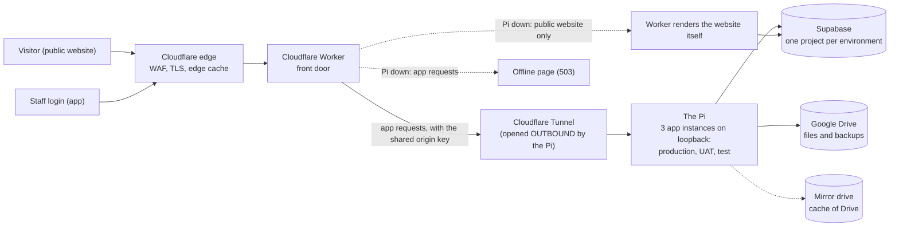

# As-built: the hardware and the technology stack, as of 2026-11-13

**What this is.** One document that says what the shelter's system physically and logically *is*, with
the security measures gathered where a reader can see them together. It is dated in its filename on
purpose. An as-built is wrong the day the hardware changes; this one says what was true on its date and
names how each section was read, so it stays useful after that instead of silently becoming untrue.
Backlog item `#s54mf`; asked for by Lutan on 2026-11-12.

**What this is not.** It is not `docs/architecture-review-2026-09-22.md`, which is a findings review of
the code (what is wrong and what to change). This records what exists. It is also not live: re-read a
line against its source before relying on it for anything that matters.

## How to read the marks

Every security statement carries one of three marks, then the date and how it was read.

| Mark | Meaning |
|---|---|
| **IN PLACE** | The control exists today and a reading of it was taken. |
| **INTENDED, NOT BUILT** | Decided or bought-for, but not running. Never read this as protection. |
| **NOT ESTABLISHED** | Nobody has read it, or the reading was inconclusive. Said so rather than guessed. |

A document that writes an intended control down as present is worse than none. When this item was filed,
all three of its headline controls were described as open; two had been done that same day. That is why
the marks are the deliverable.

## What is deliberately not in this document

This repository is public and git keeps every version (`#1wf15`,
`docs/decisions/2026-11-01-hardware-identifiers-in-a-public-repo.md`). So the **meaning** is here and the
**value** is not: no IP address, MAC, serial, device model, Wi-Fi or network name, tunnel id, account id,
or the port numbers that form a lock. Counts are given instead of tables. Where an example is needed, a
placeholder (`192.0.2.x`, `<the PC's address>`) stands in. Section 9 says where the values live.

## Contents

1. The hardware
2. Hosting and failover
3. The technology stack
4. The data stores
5. The Google identities
6. Email
7. The network and the ways in
8. The assistant's model path
9. Security measures, gathered
10. Where the values live

---

## 1. The hardware

*How read:* `docs/pi-hosting.md` (read 2026-11-13), `docs/pi-failover.md`, the Pi test results of
2026-11-01 and the home-network notes of 2026-10-24 and 2026-11-01 (Desktop; section 10). The Pi's
own state was **not** re-read for this document: the one fact taken from it, the tunnel's ingress
rules, was read on 2026-11-12.

Everything is in one house. There is no second site.

| Thing | What it is for | State |
|---|---|---|
| **The Pi** (a Raspberry Pi single-board computer) | Renders the staff app and the public website for all three environments, runs the tunnel's connector, takes the nightly database backup, keeps the Drive mirror. Alone on its own small network; Wi-Fi radio disabled. | In place |
| **Its fast drive** (NVMe) | The Pi boots and runs from it. | In place |
| **Its spare boot drive** (USB SSD) | A weekly clone of the boot drive. Boot-tested 2026-11-01 with the fast drive physically removed: it came up and served the site. | In place |
| **The mirror drive** (large USB drive, encrypted partition) | A cache of the Drive tree. Drive stays the source of truth. The partition comes back *locked* after a power cut, by decision, so the nightly job fails visibly rather than the key sitting unlocked on disk. | In place |
| **The VPN router** | Sits between the Pi and the rest of the house. Holds the rules in section 7. | In place |
| **The main home router and its mesh** | The house network everything else lives on. Its firmware is old. The ISP's own router sits in front of it and cannot be inspected. | In place |
| **A PoE switch** | Carries the Pi's cable. **Port isolation on this switch was the cause of the 2026-10-31 outage** (ports could reach the uplink but not each other); it is now off. | In place |
| **The PC** (Windows) | Lutan's workstation. Holds the production secrets and runs the Claude sessions. Reached remotely only over the private mesh (section 7). BitLocker is on. | In place |
| **A home-automation box** | Polls the app's health feed (`docs/home-assistant-monitoring.md`). It lives on the main network, not behind the VPN router. | In place |
| **A battery (UPS) for the Pi and its network path** | Chosen, specs in hand, waiting on a sale. | **INTENDED, NOT BUILT** (`#gvnrr`). Today a power cut takes the Pi down; the measured outage on 2026-11-01 was 55.6 seconds, with about 20 seconds from power back to serving. |
| **A machine to run the assistant's model** | Lutan's own computer, across the home network. | **INTENDED, NOT BUILT** (`#z04wr`): confirmed on 2026-11-10 that the machine does not exist yet. |

Outage expectation recorded by Lutan on 2026-10-26: power cuts about once every six months, never
longer than about two hours.

## 2. Hosting and failover

*How read:* `docs/pi-hosting.md`, `docs/pi-failover.md`, `scripts/pi/cloudflared-config.yml`,
`wrangler.jsonc` (all 2026-11-13), the power-pull drill of 2026-11-01, and
`docs/decisions/2026-11-12-worker-serves-the-website-not-the-app.md`.

**The path.** A visitor or staff member reaches the Cloudflare edge. A Cloudflare Worker is the front
door. For the staff app it forwards to the Pi through an **outbound** tunnel the Pi opens to Cloudflare,
so nothing is opened inward for visitors. The Pi renders and talks to Supabase and Drive. For anonymous
public pages the Worker first tries an edge cache (about ten minutes).

**When the Pi is down (changed 2026-11-12, #dxjz2).** The Worker now serves **only the public website**
and **refuses the staff app with a small self-contained offline page** (English and Thai, no external
request). Before this the Worker tried to render the app itself and was killed by Cloudflare's CPU
limit; the drill showed 113 of 180 saves reaching nothing. A write that provably never reached the Pi
gets the offline page; a write that may have reached it keeps the "check whether your change was saved"
answer, because the Pi may have acted. Every response carries an `x-lanna-served-by` header naming who
answered.

**Marks for this section**

- Tunnel is outbound-only, and the app listens on the Pi's loopback address only: **IN PLACE**
  (read from the tunnel config 2026-11-12 and the listening-sockets reading of 2026-11-07).
- Worker-serves-website-not-app: **IN PLACE in the repo; NOT LIVE on production.** The decision file
  says it ships with the next Worker deploy, which is Lutan's. Re-read the deployed Worker before
  relying on it.
- The public website is still locked on production, so today only the home page benefits; the change is
  built for go-live (same decision file).
- **NOT ESTABLISHED:** where the Worker's CPU ceiling really is, and whether production behaves as test
  did (the drill ran on test). The website path is built to degrade, not to be guaranteed. The next free
  step, if it bites, is serving the website from the edge cache.
- Recovery numbers, measured 2026-11-01: boot from the USB clone works (**IN PLACE**); a retried save
  cannot write twice because each save carries its own request id (**IN PLACE**, zero duplicates in 240
  attempts). Not an in-place control: the Pi's clock restarts from a stale time after a power cut, so
  early log timestamps after one are wrong.

## 3. The technology stack

*How read:* `README.md`, `wrangler.jsonc`, `scripts/pi/setup.sh`, `docs/pi-hosting.md` (2026-11-13).

| Layer | What | Runs where |
|---|---|---|
| The app | Next.js (a version with breaking changes from the one most people know; read `node_modules/next/dist/docs/` before changing it) | On the Pi as a long-running server, three separate instances, one per environment, each from its own clone and its own system user |
| The front door | A Cloudflare Worker, one per environment, plus a bundled copy of the app used only for the public website when the Pi is down | Cloudflare |
| The database and sign-in | Supabase (Postgres, Auth, row-level security) | Supabase, hosted in Mumbai |
| Files | Google Drive, written through the app's own Desktop OAuth client | Google |
| Mail | Two senders; see section 6 | Cloudflare and Resend |
| Machine translation | Cloudflare's Workers AI binding, a 15-minute scheduled job on test and production | Cloudflare |
| Monitoring | A scheduled health check every 15 minutes on the Worker; a read-only health feed for the home-automation box | Cloudflare and the Pi |

**Environments, by what each is for.** *Production* is the live shelter. *UAT* is the customer's
acceptance testing (live at its own address since 2026-11-08, with its own database, its own Pi
instance and its own Drive bucket). *Test* is the developers' environment on the **dev database**, which
is disposable. A deploy of production or UAT is guarded: it refuses when release notes are unreleased,
the version is not the newest release, the database lacks a migration the commit carries, or the commit
is not on `origin/main`. Test is unguarded.

**One Pi instance never carries another's secrets.** The test instance holds the dev database only and
refuses to run if a production or UAT values file is in its folder; UAT holds only UAT's; the
production folder refuses a `.env.local`. These are checks in `deploy-pi.sh`, not conventions.

## 4. The data stores

*How read:* `docs/pi-hosting.md`, `docs/decisions/2026-11-07-drive-buckets.md`,
`docs/uat-finalisation.md`, `README.md` (2026-11-13). No production read was made for this document.

**Three Supabase projects**, none listed by id here:

| Project | For | Notes |
|---|---|---|
| Production | The live shelter's records | Own sign-in client; own mail key. Daily encrypted backup (section 9). |
| UAT | The customer's acceptance testing | Separate project on a second Supabase account; its own sign-in client and mail key since 2026-11-08. |
| Dev | Test and development | Disposable. Wiped before the real migration. |

**One Google Drive account, three buckets.** Since 2026-11-07 each environment writes into its own
folder tree inside the one Drive: a Production root, a UAT root and a Test root. The tree holds
residents, photos, documents, blood work, procedures and archive PDFs; backups sit in their own
`Backups` folder. **NOT ESTABLISHED here:** how widely the Drive tree is shared today. That is the
subject of the Drive lock-down stream, a separate piece of work; take its figures from its record, not
from this document.

**The Pi's own storage.** The encrypted nightly database dumps (14 days kept; never the newest five),
the encrypted mirror partition, a photo cache per environment, and the spare boot clone. The
production database is **not** on the Pi; the dumps are the one exception, and are readable only as
ciphertext.
