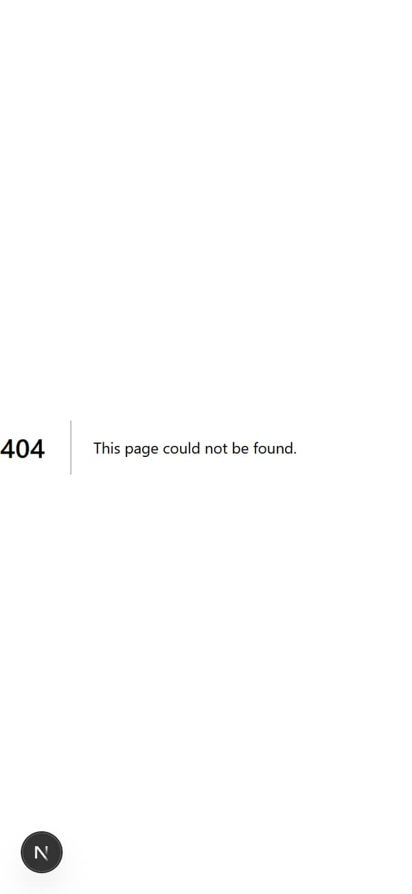
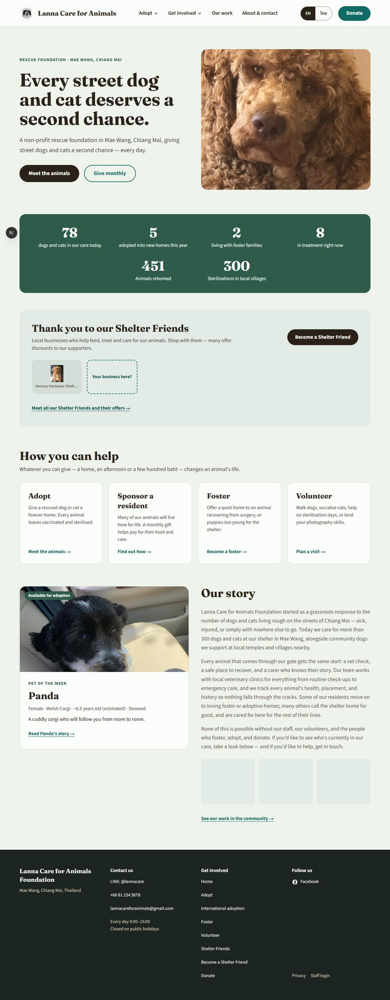
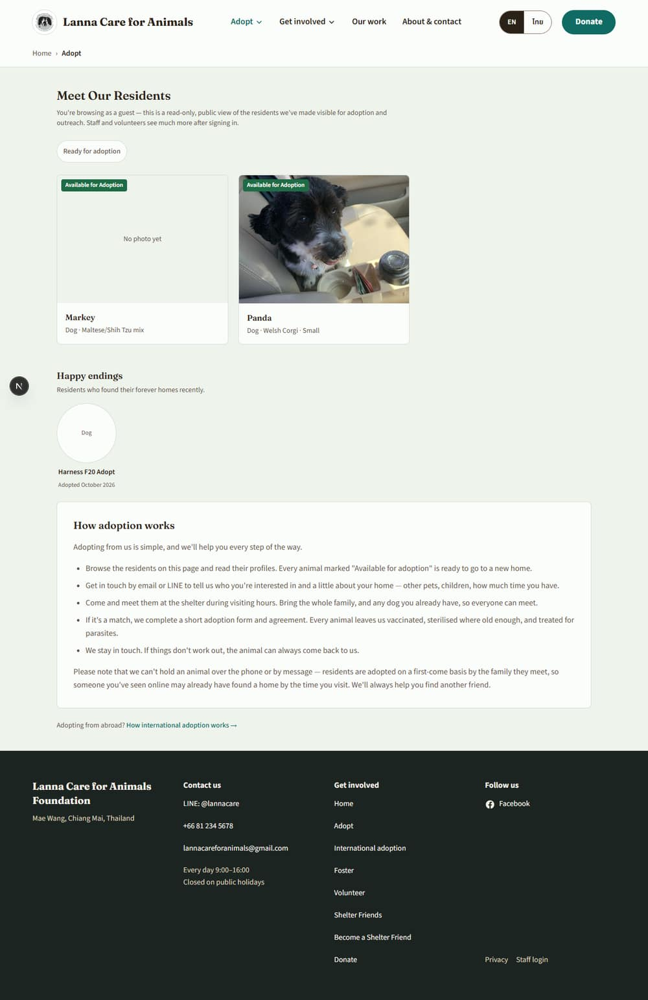
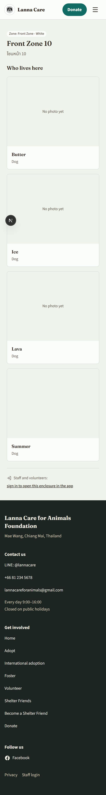
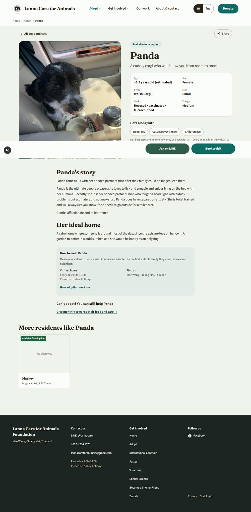
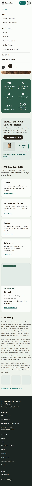
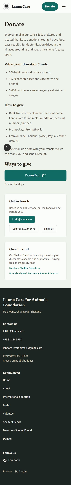

# Public website review — requested 2026-10-13, written 2026-10-13

A review of the public pages of Lanna Care for Animals as a first-time visitor would meet them:
on a phone (375 px wide) and on a laptop (1280 px), in English and in Thai, signed out, on a local
dev server running this branch against the **dev** database. Production was not opened. Nothing
was changed: this review is a document, and every suggestion in it is written as a backlog item
for Lutan to accept or leave. Which ones become work is his call after the walkthrough.

This repository is public. Every screenshot shows dev data only (test animals, a test business,
a dummy phone number) and the report names no donor, adopter, carer or private person. Where a
suggestion needs the shelter's own words, a draft is given in English in Appendix A for the
Director to correct; nothing drafted here is published.

It builds on the redesign that shipped on 2026-09-26 (`docs/decisions/2026-09-26-public-site-redesign-part-1…3`),
the 2026-10-04 findings pass (F-16 and part of F-11 are done and are not raised again), the
2026-10-07 links and impact-figure decisions, and the open public-site items in `docs/backlog.md`.
Where a suggestion is already planned, the report says so and points at the item instead of
proposing it a second time.

**Two things to know before reading the screenshots.** The dev database paints the site's action
colour teal and the ground a pale green, so a public page on test is never mistaken for the live
site; on production the same buttons are terracotta on cream. And the black circle with an "N" in
the bottom-left corner of some screenshots is Next.js's own development badge, not part of the
site.

---

## The five-minute version

**What the site is.** Thirteen public pages: the home page, the adoption list and one page per
animal, international adoption, Our work and one page per story, Shelter Friends and how to become
one, Donate, Foster, Volunteer, Privacy, and the two pages behind a scanned name card or enclosure
tag. All of it reads from the same database as the staff app, so what staff type about an animal is
what a visitor sees minutes later.

**Is it in good shape?** Yes. The redesign that landed on 26 September gave the site a warm,
distinct look, and the home page and the animal pages are genuinely good: a visitor on a phone sees
a big headline, two clear buttons and a photo in the first screen, and an animal's page answers the
questions an adopter asks (age, sex, size, health, gets along with, how to meet, ask on LINE). The
measurements agree with the eye: across 72 page loads at two widths and two languages, **no page
scrolls sideways on a phone, no text fails the contrast standard, every header, menu and footer
control is at least 44 px, every photo has a description for screen readers, and the Thai menus,
labels and buttons are all translated and all fit.** Pages are light (a quarter to half a megabyte
with photos). That is a better base than most small shelters have.

**What lets it down.** Five things, in the order a visitor would hit them.

1. **The Thai site is English where it matters.** Every menu and button is Thai, but every long
   text is still English: the shelter's story on the home page, how adoption works, Foster,
   Volunteer, Donate, and each animal's story. On Foster, Volunteer and Donate a Thai note explains
   this; on the home page and the adoption list there is no note, so the English just looks like a
   mistake. The fix is mostly the Director's words (six texts, already queued for translation), plus
   a small code change to show the note in the two places that lack it. Also: a Thai phone lands in
   English, because the site only remembers a choice, it never asks the phone its language.
2. **A shared link to an animal that has since been adopted lands on a bare "404 — This page could
   not be found."** No header, no footer, no way back, in a different font, and the page answers
   "all is well" (status 200) to anything that checks links. That is the single most common broken
   moment a shelter site has: people share animals on Facebook and LINE and the animal finds a home.
   Half a day to fix, no words needed from the shelter.
3. **The Donate page asks for money in the wrong order and still shows placeholders.** A donor reads
   the intro, three "what your donation funds" lines, then a "How to give" list that says "(bank
   name)", "(number)", "(PromptPay id)" and "(Wise / PayPal / other details)", and only then reaches
   the real DonorBox button under "Ways to give". The placeholder part is already on the backlog
   (the Director's step, item *Donate page: finish the hand steps*). The order is a small code
   change: buttons first, reasons after.
4. **Three promises lead to a page that keeps none of them.** "Give monthly" (home page),
   "Sponsor a resident" (menu, home card) and "Give monthly towards their food and care" (every
   animal's page) all go to the Donate page, which offers neither a monthly gift nor a sponsorship.
   Sponsorship drives are planned (backlog, *Sponsorship drives for sick residents*); until they
   exist, the words should promise what the page delivers. Fifteen minutes of wording.
5. **On a phone, the ways to talk to the shelter are hidden.** The menu's "Talk to us" panel
   (LINE, Call) sits 93 px below the bottom of a 375 × 812 phone screen, with nothing to say the menu
   scrolls. The footer, the other place the LINE id lives, is 5.6 screens down the home page. A
   visitor who wants to ask about an animal will find "Ask on LINE" on the animal's page, but from
   anywhere else, contact is two taps and a scroll they have no reason to expect. Half a day.

**What a visitor cannot find at all.** There is no page about the shelter itself: who runs it, how
long it has existed, its registration as a foundation, where exactly it is and how to get there, and
what a visit is like. "About & contact" in the menu jumps to the footer. Overseas donors look for
exactly those things before giving, and the three comparison sites (Soi Dog, Lanta Animal Welfare,
The ARK in Chiang Mai) all have them. This needs the Director's words and a few photos, not code
first; Appendix A has a draft to correct.

**For search engines, the Thai site does not exist.** Language is remembered in a cookie, so every
page has one address and Google only ever sees the English version. Fixing that is a routing
change (`/th/…` or `?lang=th` with the right link tags) and is the one large item in this report;
it is worth deciding before go-live but it is not a go-live blocker. Smaller search wins: the home
page carries no structured data saying "this is an animal shelter at this address with these
hours", the Our work list and five other pages share without a picture, and there is no sitemap.
(The missing canonical tag is already on the backlog with the Search Console item.)

**What to look at first.** Open the site on your phone, switch to Thai, and read the home page to
the bottom. Then tap any animal, copy its link, and open it after the animal is marked adopted.
Those two walks show items 1 and 2 above better than any screenshot.

**The suggestions, ranked by how much they help a visitor for the effort.** Details and
ready-to-paste backlog items are in §3–§8. "Needs" says whether the work is code, the Director's
words, photos, or a decision. Sizes: S = under a day, M = one to three days, L = a week or more.

| # | Suggestion | Who it helps | Needs | Size |
|---|---|---|---|---|
| 1 | A kind, branded "not found" page with a way back, and a true 404 where the page can give one (§3.1) | Everyone who follows an old link | Code | S |
| 2 | Donate page: ways to give first, reasons after; placeholders out; a sentence under each button (§6.1) | Every donor | Code + Director's data (item already filed) | S |
| 3 | Thai texts for the six long pages, and the "English for now" note on the two places that lack it (§5.1) | Every Thai visitor | Director's words + code | S code, M words |
| 4 | Phone menu: Talk to us on the first screen (§4.1) | Phone visitors | Code | S |
| 5 | Say what the Donate page actually offers until sponsorship exists (§6.2) | Donors; trust | Words (dictionary) | S |
| 6 | Tap targets under 44 px on seven kinds of link (§3.2) | Phone visitors | Code | S |
| 7 | Speak to the visitor on the adoption list, and call the list one thing (§5.2) | Adopters | Words (dictionary) | S |
| 8 | An About / Visit us page: the people, the place, the hours, how to get there (§5.3) | Donors, adopters, volunteers | Director's words + photos, then code | M |
| 9 | Trust block: registration number, who we are, where the money goes (§6.3) | Overseas donors | Director's data + code | S–M |
| 10 | Structured data for the shelter, a default share picture, share tags on Our work (§8.2) | Search, Facebook and LINE shares | Code | S |
| 11 | First visit in the phone's own language (§4.4) | Thai visitors | Code | S |
| 12 | Bring the inner pages up to the redesign's scale (§3.3) | Everyone; consistency | Code | M |
| 13 | A give-link at the end of every story (§6.4) | Donors | Code | S |
| 14 | One badge for "available for adoption"; friendlier empty photo frames (§3.4) | Adopters | Code (+ photos from the shelter) | S |
| 15 | Animal page on a laptop: buttons in the column, not a bar across the screen (§3.5) | Laptop visitors | Code | S |
| 16 | Tagline and story: stop repeating the headline, take the number out of the story (§5.4) | Everyone | Director's words | S |
| 17 | A LINE QR code and a Thai address line (§5.5) | Thai visitors | Code + one small schema change | S |
| 18 | "Animals rehomed since <year>": a period on the big numbers (§5.6) | Donors; trust | Code + one date from the Director | S |
| 19 | Home page title with a descriptor (§8.3) | Search | Code | S |
| 20 | Thai pages at their own addresses so search engines can find them (§8.1) | Thai search visitors | Decision, then code | L |
| 21 | What the domain split does to Staff login, Open the app and the card pages (§4.5) | Staff | Note for the split build | — |
| 22 | Sitemap (§8.4) | Search | Code; fold into the Search Console item | S |

---

## 1. Coverage: what was looked at, how, and what was not

### How

- **Where:** `next dev` on port 3001 from this branch (`claude/public-site-fable-review`, cut from
  `main` at `4b868b84`), reading the **dev** database (`qxkmhwybjggxvsfxsxbd`). Signed out
  throughout: locally the public site is not locked, so a signed-out visitor sees exactly what the
  live site will show after go-live. Production and `test.lannacare.org` were not opened.
- **With what:** a headless Chrome driven by a throwaway script (`audit.mjs`, in the session's
  scratchpad, not committed) that loaded every page below at 375 × 812 (touch, 2× pixels) and at
  1280 × 800, once with the language cookie set to English and once to Thai, took a full-page
  screenshot of each, and measured: sideways overflow, every visible link and button under 44 px,
  the contrast of every piece of text against its real background, heading order, images without a
  description, page title, description, Open Graph and Twitter tags, canonical and language tags,
  structured data, text under 14 px, the element that receives keyboard focus after three Tab
  presses and whether it shows a ring, the page's weight, how many screens down the footer and the
  contact card sit, placeholder text, English runs on Thai pages, and failed requests. The phone
  menu was opened and each of its entries measured; the laptop's two menu groups were opened.
  Then the pages were read by eye in the desktop app's browser pane at 375 px and at the pane's
  width, and the live links behind "Ask on LINE", "Book a visit" and the footer were read off the
  page.
- **Comparison sites:** the public home pages of Soi Dog Foundation (Phuket), Lanta Animal Welfare
  (Koh Lanta), The ARK Foundation (Doi Saket, Chiang Mai) and the RSPCA (UK) were read once each
  and are described in §7 in the review's own words.

### Pages and widths

Every cell was captured and measured; ✓ means looked at by eye as well.

| Page | Path | 375 EN | 375 TH | 1280 EN | 1280 TH |
|---|---|---|---|---|---|
| Home | `/` | ✓ | ✓ | ✓ | ✓ |
| Phone menu, open | `/` | ✓ | ✓ | — | — |
| Laptop header, Adopt and Get involved open | `/` | — | — | ✓ | ✓ |
| Adoption list | `/adopt` | ✓ | ✓ | ✓ | ✓ |
| Adoption list, filtered | `/adopt?species=Dog&ready=1` | ✓ | measured | measured | measured |
| Animal with a full profile | `/adopt/<Panda>` | ✓ | ✓ | ✓ | ✓ |
| Animal with a blank profile | `/adopt/<Markey>` | measured | measured | measured | measured |
| International adoption | `/adopt/international` | ✓ | measured | ✓ | measured |
| Our work | `/our-work` | ✓ | measured | measured | measured |
| A story | `/our-work/<id>` | ✓ | measured | measured | measured |
| Shelter Friends | `/friends` | ✓ | measured | measured | measured |
| Become a Shelter Friend | `/friends/join` | measured | measured | measured | measured |
| Donate | `/donate` | ✓ | ✓ | ✓ | measured |
| Foster | `/foster` | measured | measured | measured | measured |
| Volunteer | `/volunteer` | measured | measured | measured | measured |
| Privacy | `/privacy` | measured | measured | measured | measured |
| Name card, animal not public | `/r/R-0014` | measured | measured | measured | measured |
| Name card, animal deceased | `/r/R-0395` | ✓ | measured | measured | measured |
| Enclosure tag | `/e/<id>` | ✓ | measured | measured | measured |
| A wrong link | `/adopt/0000…` | ✓ | measured | ✓ | measured |

### What was not looked at

- **Production and the test site.** By the brief. The live data (real photos, the real LINE id and
  phone, the Director's texts) will change how several pages read; the dev database has two public
  animals, one story, one test business and one way to give.
- **A real phone.** Chrome's phone emulation and the desktop app's pane at 375 px, not an iPhone or
  an Android handset; the Web Share sheet and LINE's app hand-off were read from the links, not
  tapped.
- **A screen reader.** Headings, labels, alt text and focus were measured; nobody listened to the
  pages.
- **Thai as a native reader would.** The Thai texts in the dictionary read naturally to this
  reviewer and the Thai menu fits, but a Thai speaker should still read the home page once before
  go-live (this is a known gap for every Thai string in the app, not new here).
- **The signed-in states** of the public header ("Open the app", "Sign out") and of the card pages
  ("public-plus"). Those are staff views, covered by the 2026-10-07 name-card decision and its
  check script.
- **Load time from Thailand.** The dev server runs on the laptop; the photo sizing of 2026-10-01 is
  the relevant work and is not re-measured here.

---

## 2. What works well and should be kept

These are the things a redesign of the inner pages (§3.3) must not lose.

- **The visual system reads as one organisation.** Cream ground, a dark footer, one action colour
  for every "do something" and one green for "talk to us", Fraunces headings over Source Sans. The
  contrast was measured on every text element of every page at both widths in both languages:
  nothing fails the AA standard. (The only thing the script flagged, the category label on a story
  card, sits on a dark band over a photo and is fine by eye.)
- **It fits a phone.** No page is wider than the screen at 375 px. The header's menu button, the
  Donate button, the language toggle, every menu entry and every footer link measure 44 px or
  more. The first screen of the home page is a headline, two buttons and the top of the photo.
- **The phone menu behaves like a proper dialog:** focus moves in and stays in, Escape closes it,
  the page behind does not scroll, and the entries are 44–56 px tall.
- **The animal page is the best page on the site.** Badge, name, one-line hook, six quick facts,
  "Gets along with" chips with an honest caveat, the story, the ideal home, a "How to meet" box
  with hours and address, and a bar that stays on screen with "Ask on LINE" (which opens LINE with
  "Visiting Panda" already typed) and "Book a visit" (which dials the shelter). The share button
  uses the phone's own share sheet. A shared link previews with the photo and the hook, in Thai
  when the reader is Thai.
- **Every block drops out when it has nothing to say**, so an animal with no story still reads as
  a short, complete page rather than a page of empty headings.
- **Honesty in the words.** "Animals are adopted by the first suitable family they meet, so we
  can't hold them." "Our best assessment from how they've been with us — every animal is an
  individual." The Thai "this page is in English for now" note on Foster, Volunteer and Donate.
- **The Thai chrome is complete.** Header, menu, footer, buttons, badges, quick-fact labels, the
  contact card, the ways-to-give labels, the privacy notice: all Thai, all fitting, with the right
  `lang` on the page so screen readers switch voice.
- **Ways to give** have a copy button with a fallback, a QR with a caption, and only allow-listed
  company links.
- **Links in staff-written text are safe** (allow-listed schemes, new-tab announced to screen
  readers) and the back link restores the list's scroll position.
- **Search basics are right where they exist:** every page has a title and a description, inner
  pages carry a breadcrumb with its structured data, the card and tag pages are marked not to
  index, and the share tags on the home page, animal pages and stories carry a real photo.
- **Keyboard focus is visible** on every page (the browser's own ring on the cream ground is
  clear), and the "N" dev badge is the only thing that steals it.
- **Pages are light:** 240–600 KB with photos at 375 px, fonts included. Photos are served at the
  sizes the layout needs.

---

## 3. Design

### 3.1 The "not found" page is Next's default, and it answers 200

**What a visitor sees.** `/adopt/<id of an animal that is no longer public>` — and `/r/<unknown
code>`, and any mistyped address — shows a white page with "404 | This page could not be found."
in the system font, no header, no footer, no link anywhere. Measured: 0 links on the page, the font
is `system-ui`, and the HTTP status is **200**, not 404 (the root `loading.tsx` streams the page
shell before `notFound()` runs, so the status can no longer change; Next does add a `noindex` tag,
so search engines will not index it, but link checkers and Facebook's debugger see a healthy page).

**Why it matters.** The most-shared link on a shelter site is an animal, and the happiest outcome
is that the animal is adopted and disappears from `/adopt`. Every one of those shares then lands
here. It is also where a scanned tag lands if a code is mistyped.

**Ready to paste:**

- [ ] **A branded "not found" page for the public site, with a way back.** Add `not-found.tsx`
  under the public routes (`src/app/adopt/`, `our-work/`, `r/`, `e/`, or one at `src/app/` that
  renders the public shell when the path is public): the public header and footer, a short kind
  message ("We couldn't find that page. If it was an animal, they may have found a home."), and
  three links: all dogs and cats, our work, home. For `/adopt/<id>` specifically, when the id
  exists but the animal is no longer public (adopted, hidden, deceased), say that instead of "not
  found" and show "Happy endings" — the data is already in `public_resident_cards`. Return a real
  404 where the page can (move the loading boundary below the public routes, or `notFound()` in
  `generateMetadata`); where it cannot, the `noindex` Next adds is acceptable. Dictionary strings in
  both languages. **Size:** S (half a day). **Needs:** code only. → *Public website*

### 3.2 Tap targets under 44 px

The header, menu and footer were fixed on 2026-10-07 and measure clean. Inside the pages, seven
kinds of control are still short, every one of them on a phone:

| Control | Where | Measured (w × h) |
|---|---|---|
| "LINE @…", "Call …", "Email us" buttons in the Get in touch card | Donate, Foster, Volunteer, International adoption, Become a Shelter Friend | 134 × 36, 154 × 38, 85 × 38 |
| "See also: Adopt · Our work" links | the same five pages | 36 × 20, 55 × 20 |
| "Website", "LINE @…", email buttons on a Friend's card | Shelter Friends | 95 × 34, 194 × 34 |
| "Open in Google Maps" under a Friend's map | Shelter Friends | 107 × 16 |
| "Become a Shelter Friend →", "How international adoption works →" | Shelter Friends, Adopt | 300 × 40, 302 × 40 |
| "Meet our Shelter Friends →", "Run a business? …" | Donate | 163 × 20, 260 × 20 |
| The category link ("RESCUES"), "sign in to see the full record" | a story, the card and tag pages | 58 × 20, 162 × 20 |
| The thumbnail-strip arrow "›" | animal and story galleries on a laptop | 32 × 32 |

The first row is the one that matters: those three buttons are the way a visitor who has read
Foster or Volunteer actually gets in touch.

**Ready to paste:**

- [ ] **Bring the public pages' in-page links and buttons to 44 px on phones.** The Get in touch
  card's three buttons (`SitePageView.tsx`, `px-4 py-2` → `min-h-11 px-5`), the "See also" row,
  the Friend card's contact buttons and "Open in Google Maps" (`FriendCard.tsx`), the two "→"
  links on `/adopt` and `/friends`, the Donate page's two Shelter Friends links, a story's category
  link, the card pages' "sign in" link, and the gallery arrow (`ThumbnailStrip`). The rule the app
  already uses: 44 px on phones, 36 px with a mouse. Add these pages to
  `scripts/check-phone-width.mjs` so they stay fixed. **Size:** S (half a day). **Needs:** code. →
  *Public website*

### 3.3 Two sites in one: the inner pages still wear the old layout

The redesign rebuilt the shell, the home page and the animal page against the mockups. Everything
else — the adoption list, Our work and its stories, Shelter Friends, Donate, Foster, Volunteer,
International adoption, Privacy, the card and tag pages — kept the layout it had before, and only
inherits the new colours and fonts. Side by side the difference is plain: the home page's heading
is 40 px on a phone and 60 px on a laptop; the adoption list's is 24 px, over a 14 px grey
subtitle, in a page with the proportions of an admin screen. Cards on the home page have 20 px
corners and 28 px of padding; cards on `/adopt` and `/our-work` have 8 px corners and 16 px.

On a laptop the Donate, Foster and Volunteer pages are a single narrow column of text in the middle
of an empty cream screen, with no picture. That is fine for Privacy; for Donate it is the one page
where a photo of what the money does would earn its place.

**Ready to paste:**

- [ ] **Public site redesign, part 5: the inner pages.** Apply the shell's type scale and spacing to
  `/adopt`, `/our-work` and `/our-work/[id]`, `/friends` and `/friends/join`, the five
  `SitePageView` pages, `/privacy`, `/r/[code]` and `/e/[id]`: the home page's heading sizes
  (`font-display`, 40/60 px), a one-line intro at 18–20 px instead of 14 px muted, the 20 px card
  radius and padding from `ResidentCard`'s cousins on the home page, and a photo slot beside the
  heading of each `SitePageView` page (the international page already has the puppy; Donate, Foster
  and Volunteer take a photo chosen in Settings → Website, like the hero). Keep every behaviour
  (filters, back link, galleries, the share button). No mockup exists for these pages; the home
  page and the animal page are the reference. **Size:** M (two to three days). **Needs:** code; a
  photo per page from the shelter is optional and can come later. → *Public website*

### 3.4 Badges and empty frames

- **"Available for adoption" has two looks.** On the home page and the animal page it is a soft
  green pill, "Available for adoption". On every card (`/adopt`, "More residents like…", the
  enclosure page) it is a hard green square, "Available for Adoption" (capital A). Same fact, two
  designs, two spellings.
- **Empty photo frames are large and blank.** A card with no photo is a tall sand box saying "No
  photo yet"; a "Happy endings" circle with no photo says "Dog" in the middle; on the home page the
  three story-gallery tiles were blank squares when their photos did not load (Drive was slow on
  dev). On production most animals will have photos, but new arrivals will not, and the first card
  a visitor sees should never be a blank.

**Ready to paste:**

- [ ] **One "available for adoption" badge, and a friendly empty photo.** Make `ResidentCard`'s
  badge the home page's pill (`bg-site-accent-soft`, sentence case, one dictionary key for both
  languages). Replace "No photo yet" boxes with the puppy drawing (`PuppyLoader` art already in the
  repo) at a smaller height, and give the "Happy endings" circle a paw mark instead of the word
  "Dog". On the home page, drop a gallery tile whose image fails to load (`onError`) rather than
  showing a blank. **Size:** S. **Needs:** code. (Photos for every animal are the shelter's own
  job and the better fix.) → *Public website*

### 3.5 The animal page on a laptop: the sticky bar

On a phone the bar with "Ask on LINE" and "Book a visit" is exactly right. On a laptop it becomes a
full-width white band across the bottom of a 1280 px screen holding two buttons at the right, and
in the first screen it sits over the thumbnail strip under the photo. The right-hand column, under
the quick facts, has room for both buttons, where a laptop visitor's eye already is.

- [ ] **Animal page, laptop width: put "Ask on LINE" and "Book a visit" in the right column and
  drop the sticky band from `lg` up.** Keep the phone exactly as it is. `src/app/adopt/[id]/page.tsx`,
  one `lg:` variant. **Size:** S (an hour). **Needs:** code. → *Public website*

### 3.6 Small things seen and not raised as items

- Text at 12 px: the badges, "Adopted October 2026", "OFFER FOR SUPPORTERS", "Showing 2 of 2
  residents". Fold into §3.3.
- The Our work category label on a story page is in capitals with letter-spacing ("RESCUES"), the
  only place the site shouts. Fold into §3.3.
- The impact band's second row (two figures under four) is centred and reads fine at both widths;
  when the seventh figure arrives (outreach, backlog) it will be 4 + 3, also fine.
- Keyboard focus uses the browser's default ring. It is visible on cream; a site-coloured ring
  would be nicer, not necessary.
- Fonts: 200–230 KB per first page load across three families (Fraunces with its optical-size axis,
  Source Sans, Noto Sans Thai). Not a problem; if it ever is, dropping Fraunces's `opsz` axis is the
  cheap saving.

---

## 4. Navigation

### The two-tap test

From the home page on a phone, signed out:

| Goal | Taps | Where |
|---|---|---|
| Adopt | 1 | "Meet the animals" in the first screen, or Adopt in the menu |
| Donate | 1 | The header button on every page |
| Foster | 2 | Menu → Foster, or scroll two screens to the card |
| Volunteer | 2 | Menu → Volunteer, or the card |
| Contact the shelter | 2 + a scroll | Menu → scroll inside the menu → LINE or Call (§4.1); or 5.6 screens down to the footer; or "About & contact", which jumps to the footer |
| Ask about one animal | 2 | Animal → "Ask on LINE", which is always on screen |
| Where the shelter is, and when it is open | 2 + a scroll | The footer, or the "How to meet" box on any animal's page |
| Become a Shelter Friend | 1 | Home page band, or menu |

Everything a visitor would want is reachable, and nothing is a dead end except the not-found page
(§3.1). The weak link is contact from anywhere that is not an animal's page.

### 4.1 Phone menu: Talk to us is below the fold

Measured at 375 × 812 with the menu open: the entries run from 80 px to 716 px, the language row
sits at 737 px, "Staff login" at 798 px (its top is 14 px above the bottom edge), and the "Talk to
us" buttons start at **905 px** — 93 px below the screen — with "Follow us" at 1005 px. The menu
scrolls (its content is 1069 px tall), but nothing says so: the last visible thing is a quiet
"Staff login". The mockup's whole point of the panel at the foot of the menu was LINE-first contact
for phones.

- [ ] **Phone menu: show Talk to us without scrolling.** Options in order of cheapness: put
  "Language" and "Staff login" on one row (saves ~60 px); tighten the group padding (`py-3.5` and
  the 56 px top-level rows to 48 px, saves ~50 px); or make the Talk to us panel stick to the bottom
  of the dialog while the entries scroll above it (`PublicNav.tsx`, the dialog becomes
  `grid-rows-[auto_1fr_auto]` with the nav `overflow-y-auto`). Measure at 375 × 812 (iPhone SE
  size, 375 × 667, is the hard case) and add the menu to `check-phone-width.mjs`. **Size:** S.
  **Needs:** code. → *Public website*

### 4.2 "About & contact" goes to a footer

The menu's fourth entry jumps to `#contact`, the footer, on whatever page the visitor is on. The
footer has the address line, the contact channels and the hours, so the "contact" half is honest.
The "About" half is a story paragraph on the home page and nothing else: no page says who runs
the shelter, when it began, what it is registered as, or what a visit is like. See §5.3 for the
page, and §6.3 for why donors look for it.

### 4.3 Four names for the same list

A visitor meets the adoption list as "Meet the animals" (hero button and home card), "Meet our
residents" (menu), "Adopt" (footer, breadcrumb, "See also"), "Meet Our Residents" (the page's own
heading, in Title Case) and "All dogs and cats" (the back link from an animal). "Residents" is the
app's word for an animal and means little to the public. See §5.2.

### 4.4 First visit: always English

The site remembers a language choice in a cookie and defaults to English; it never reads the
phone's own language (`getLocale()` reads the cookie only, nothing reads `Accept-Language`). A
Thai phone with Thai set as its language lands on an English home page and has to find the toggle.

- [ ] **Pick the first language from the phone.** When there is no `locale` cookie, read the
  request's `Accept-Language` in `getLocale()` (or the proxy) and choose Thai when it is the first
  preference, then set the cookie so the toggle still wins afterwards. Three lines, plus a test
  that the toggle overrides it. **Size:** S. **Needs:** code. → *Public website*

### 4.5 What the domain split does to the links between the two sites

Decided 2026-10-10: the public site moves to `lannacareforanimals.org`, the staff app stays on
`lannacare.org`. Today both are one origin and share one session, which these links assume:

- **Staff login** (footer on every page; phone menu) is `/login` on the same host. After the split
  it must be an absolute link to the app's address, from the setting the split item defines, and
  it is the only cross-domain link on the public site. On a laptop it stays in the footer (a short
  scroll); the 2026-10-04 decision to keep it off the laptop header still holds.
- **"Open the app" and "Sign out" in the public header** exist because staff and public viewers
  can be signed in on the same host. Cookies do not cross registrable domains, so after the split a
  visitor to the public site is never signed in and these two states simply never render. That is
  fine, and worth saying in the split's decision file so nobody re-adds them.
- **The card and tag pages** (`/r/<code>`, `/e/<id>`) decide who scanned by the session. After the
  split the printed cards carry `lannacare.org` (the app), and the split item already keeps that
  host redirecting. If the public card page ends up on the public domain, its "Staff and volunteers:
  sign in to see the full record" link must send staff to the app's `/login?next=` and the app's
  `/r/` route must do the staff landing. Simplest: leave `/r/` and `/e/` served from the app host
  (they are `noindex` and never edge-cached anyway), and have the public host redirect those two
  prefixes to the app. Either way it is one decision in the split build, not a public-site change.
- **The locked landing page** at `/` and the `PUBLIC_SITE=locked` check become the public host's
  concern only; the app host's `/` is the sign-in.
- **The share button** copies the current page address, so it follows the domain by itself; the
  Open Graph `url` tags come from `getSiteOrigin()` and also follow.

- [ ] **In the domain-split build: make Staff login an absolute link to the app's address, record
  that the public header's signed-in states no longer apply, and decide which host serves `/r/`
  and `/e/`.** Nothing to do before that build. **Size:** folds into the split item. **Needs:**
  a decision on the card pages. → *Architecture*, under the split item

### 4.6 Not raised

- The Services group is empty and hidden until desexing drives (planned). Nothing to do.
- The breadcrumb is hidden on phones (a choice left to Lutan on 2026-09-29). The back link does
  the job; keep it.
- The footer's "Get involved" column lists Home and Donate alongside the five ways to help — a
  little long, but every link is live and a footer is where people expect a full list.
- "Sponsor a resident" sits under Get involved while "Donate" is the header button; that is the
  mockup's split and reads fine once sponsorship exists (§6.2 covers the meantime).

---

## 5. Content

### 5.1 Thai: the chrome is done, the words are not

Measured on the Thai run (every page, both widths): the untranslated text is exactly the
staff-written prose, nothing else.

| Where | What is English | A note explains it? |
|---|---|---|
| Home page | "Our story" heading and three paragraphs | **No** |
| Adoption list | "How adoption works" heading and the whole box | **No** |
| Donate, Foster, Volunteer | title and body | Yes ("หน้านี้เป็นภาษาอังกฤษไปก่อน…") |
| Each animal | story, ideal home, breed ("Maltese/Shih Tzu mix") | No (and no note belongs on a profile) |
| A story | its title | No |
| Shelter Friends | a Friend's blurb and offer | No |
| Everywhere | the address, "Mae Wang, Chiang Mai, Thailand" | No (there is no Thai column for it) |

International adoption and Become a Shelter Friend have Thai starter texts in the dictionary and
read fully in Thai. The Director's translations for the six `site_pages` texts are queued at
Management → Translations (F-11 remainder, open since 2026-10-04); Thai breed and colour are a
filed schema item. What this review adds:

- [ ] **Show the "English for now" note on the home page's story and the adoption list's "How
  adoption works" box.** Both read `sitePageText()`, which already reports `bodyIsOriginal`;
  `SitePageView` shows the note and these two call sites do not. Same note, same style, one small
  change each in `src/app/page.tsx` and `src/app/adopt/page.tsx`. **Size:** S (an hour).
  **Needs:** code. → *Public website*
- [ ] **The Director: Thai for the six public texts** (Our story, How adoption works, Foster,
  Volunteer, Donate, and the Donate page's ways-to-give notes), at Management → Translations. The
  "English for now" note disappears by itself on each page once its Thai is approved. **Size:** M
  for the words; no code. **Needs:** the Director (or a Thai volunteer she trusts). → *Public
  website*, the F-11 line

### 5.2 The adoption list speaks to staff, not to a visitor

The line under "Meet Our Residents" reads: *"You're browsing as a guest — this is a read-only,
public view of the residents we've made visible for adoption and outreach. Staff and volunteers see
much more after signing in."* A visitor does not know they are a "guest", does not need to know
what staff see, and is told twice that this is a restricted view before being told anything about
the animals. The signed-in variant is written for staff and is right where it is; the signed-out one
should talk to an adopter. The heading is in Title Case ("Meet Our Residents") while every other
page is sentence case.

- [ ] **Rewrite the adoption list's intro for an adopter, and use one name for the list.**
  Dictionary only (`adopt.pageTitle`, `adopt.pageSubtitle`, and the five labels that name the
  list). Suggested: heading **"Dogs and cats looking for a home"**; intro *"Every animal here is
  ready to meet you. Tap one to read their story, then message us on LINE or call to arrange a
  visit."* Thai: *"สุนัขและแมวที่กำลังหาบ้าน"* / *"สัตว์ทุกตัวในหน้านี้พร้อมพบคุณ แตะเพื่ออ่านเรื่องราวของเขา แล้วทักไลน์หรือโทรหาเรา
  เพื่อนัดเยี่ยมชม"*. Use "Meet the animals" everywhere the public sees the link (hero, card, menu,
  footer "Adopt" can stay as the section name) and keep "All dogs and cats" for the back link.
  **Size:** S (an hour). **Needs:** words, no decision beyond the name. → *Public website*

### 5.3 What a visitor wants and does not find

Checked against the brief's list, on dev data:

| A visitor wants | Found? | Where / what is missing |
|---|---|---|
| The shelter's story | Partly | Three paragraphs on the home page; English only in Thai mode; no founding year |
| The people behind it | **No** | Nobody is named anywhere; no photo of the team or the Director |
| Where it is | Partly | "Mae Wang, Chiang Mai, Thailand" in the footer; the map link field exists and is empty on dev; no "how to get there" |
| Opening times | Yes | Footer and the How to meet box |
| How adoption works, step by step | Yes | The box on `/adopt`, linked from every animal; English only in Thai |
| What adoption costs | **No** | The steps mention "a short adoption form and agreement" and nothing about a fee or what is included; Thai adopters ask this first |
| Success stories | Partly | "Happy endings": name, species and month, no photo of the animal at home and no words; the app's adoption updates (photos and notes from adopters) are never shown to the public |
| Impact numbers that are trusted | Partly | Live counts plus two baselines ("451 animals rehomed", "300 sterilisations") with **no period**: rehomed since when? |
| How a gift is spent | Partly | "500 baht feeds a dog for a month / 1,500 sterilises and vaccinates / 5,000 covers an emergency" — seeded on 2026-09-21 as examples and never confirmed by the Director |
| How to get in touch on LINE | Yes | Footer, menu, contact cards, "Ask on LINE"; no QR code (§5.5) |
| Registration as a foundation | **No** | The mockup had a "Registered foundation no." line; it was left out for want of the number |
| What a visit is like, whether to book, what to bring | **No** | |

The first, second, fourth and last rows are one page:

- [ ] **An About / Visit us page.** A new `site_pages` slug (`about`) rendered by `SitePageView`
  with a photo slot, linked from "About & contact" in the menu (the footer stays the contact
  anchor) and from the home page's "Our story" ("Read more about us →"). Content, from the
  Director: when and why the shelter began; who runs it (names and a photo of the team, with
  their agreement); the registration (foundation name and number, year); where it is (full
  address in Thai and English, the Google Maps link, how to get there from Chiang Mai, parking);
  visiting (hours, whether to message first, what to bring, that children are welcome / dogs on
  leads, and the rules for photographs); how to help in one line each with links. Appendix A
  has an English draft to correct. **Size:** code S (the slug, the menu link, the Settings row);
  words and photos M for the Director. **Needs:** Director's words + two or three photos. →
  *Public website*
- [ ] **Say what adoption costs and what it includes.** One sentence in "How adoption works"
  (Settings → Website → Pages → How to adopt): the fee if there is one, or "there is no fee", and
  what every animal leaves with (vaccinations, sterilisation, microchip, parasite treatment —
  already listed). Appendix A has the line. **Size:** S. **Needs:** one answer from the Director,
  no code. → *Public website*
- [ ] **Confirm or correct the "what your donation funds" figures** (500 / 1,500 / 5,000 baht),
  which were seeded as examples on 2026-09-21 and are shown to every donor as fact. **Size:** S.
  **Needs:** the Director; no code. → *Fundraising*, under the Donate hand-steps item
- [ ] **Show adoption updates to the public as success stories.** The app already stores
  adoption updates (a photo and a note from the adopter, 2026-09-27). A public view of the ones
  the adopter agreed to share (an opt-in tick on the update, the adopter's first name at most)
  would turn "Happy endings" from a row of names into a row of photos of animals in their new
  homes. Schema PR first (the opt-in column and a `public_adoption_updates` view on the
  `check-public-views.mjs` list), then the strip on `/adopt` and a line on the animal's own page
  once adopted. **Size:** M. **Needs:** code + a privacy decision (whose words and photo may be
  shown). → *Public website*

### 5.4 Wording

- **The hero repeats itself.** The headline is "Every street dog and cat deserves a second chance."
  The paragraph under it (the tagline in Settings → Website) is "A non-profit rescue foundation in
  Mae Wang, Chiang Mai, giving street dogs and cats a second chance — every day." Two sentences,
  one idea, "second chance" twice in the first ten seconds. The eyebrow above already says "Rescue
  foundation · Mae Wang, Chiang Mai", so the tagline repeats that too.
- **"Our story" carries a number that will go stale.** "Today we care for more than 300 dogs and
  cats" sits two screens above a band that counts them live (78 on dev). When the two disagree,
  the story loses and so does trust.
- **"Give monthly"** is promised in the hero; see §6.2.
- **The international page** is well written and honest ("The costs of the paperwork and the
  journey are something we talk through with you"); keep it.
- **The privacy notice** is unusually clear for one; keep it.
- **Thai labels** read naturally; two small ones a Thai reader may want to look at: "อุปถัมภ์ชั่วคราว"
  for Foster is correct but formal (Thai rescues often say "บ้านพักชั่วคราว" or "ฝากเลี้ยงชั่วคราว"), and
  "ผลงานของเรา" for Our work is fine.

- [ ] **The Director: a tagline that adds to the headline, and a story without a number.**
  Settings → Website: tagline (both languages) and the Our story page. Appendix A has drafts.
  **Size:** S. **Needs:** the Director; no code. → *Public website*

### 5.5 LINE and the address

LINE is the first channel everywhere, which is right for Thailand. Two things Thai visitors expect:
a **LINE QR code** (most Thai businesses show one; typing an id is unusual), and the **address in
Thai**. The id is on the site and a QR can be generated from the `line.me` add-friend link with no
new data; the address has no Thai column (`site_content` has `visiting_hours_th` but no
`contact_address_th`), so "Mae Wang, Chiang Mai, Thailand" appears on every Thai page.

- [ ] **A LINE QR code in the footer and the phone menu, and a Thai address line.** The QR is
  generated server-side from `lineLink()` (the app already makes QR codes for tags) and shown
  beside "LINE: @…" in the footer and under Talk to us in the menu. The Thai address is one
  nullable column `contact_address_th` on `site_content` and its field on Settings → Website,
  read through `pairedText()` like the hours. **Size:** S code + a tiny schema PR. **Needs:**
  code; the Director types the Thai address. → *Public website*

### 5.6 A period on the big numbers

"451 Animals rehomed" and "300 Sterilisations in local villages" are baselines the Director typed
plus the live count since, and the 2026-09-26 decision kept the mockup's "rehomed since [YEAR]" as
the target. Without the year, 451 is just a number; with it, it is a record.

- [ ] **Add "since <year>" to the baseline figures.** `impact_baselines` has `baseline_date`, which
  is the date the baseline was entered, not the year counting began; add a `since_year` (or
  `counting_since` date) to the row and its Settings form, and render the label as "Animals
  rehomed since 2019" in both languages. **Size:** S code + tiny schema. **Needs:** the year from
  the Director. → *Public website*, beside the outreach-figures item

---

## 6. Trust and giving

The question the brief asks: would a supporter, especially one overseas, be confident enough to
give, and is giving easy from every page?

**Easy from every page: yes.** The Donate button is in the header of every page at both widths,
the animal page has its own give line, the home page has two routes. **Confident: not yet.** The
things an overseas donor checks before giving are the things §5.3 found missing: who you are,
where you are, your registration, what the money does, and whether the page asking for money
looks finished. On dev the Donate page does not look finished.

### 6.1 The Donate page: order, placeholders, labels

Reading down on a phone: intro (good), "What your donation funds" (three unconfirmed figures),
"How to give" with four placeholders in brackets, "Please email us a note with your transfer", and
then — one full screen down — "Ways to give" with the real DonorBox button and, under it, a note
that on dev reads "Support-lca-dogs" (the campaign's slug typed as the note). The Director's
hand-steps item already covers the placeholders and the real ways to give; this review adds the
order and the labels.

- [ ] **Donate page: ways to give first.** Render `DonateWays` directly under the page's intro
  paragraph and move "What your donation funds" and the rest of the text below the buttons
  (`SitePageView`'s `after` slot becomes a `between` slot, or the Donate page composes its own
  order). Label each link button by what it does, not only the company: "Give by card or PayPal
  (DonorBox)", "Bank transfer from abroad (Wise)" — the company name stays, the verb comes first
  (dictionary strings keyed by `way`). Treat the note field as a sentence for the donor ("Any
  currency; a receipt is emailed to you") and say so in the Settings form's hint. Where DonorBox
  supports it, carry a monthly default in the link (check DonorBox's link options for a recurring
  parameter) so "Give monthly" can point at a page that offers it (§6.2). **Size:** S.
  **Needs:** code; the Director writes the one-line notes. → *Fundraising*, beside the hand-steps item

### 6.2 Three promises, one page that keeps none

| The words | Where | Lands on |
|---|---|---|
| "Give monthly" | Home hero, second button | `/donate` — no monthly option |
| "Sponsor a resident" → "Find out how" | Menu (Get involved), home card | `/donate` — no sponsorship |
| "Can't adopt? You can still help Panda — Give monthly towards their food and care" | Every animal's page | `/donate` — nothing about Panda, nothing monthly |

All three were deliberate stand-ins (decisions of 2026-09-26, parts 1–3) until the sponsorship
flow exists, and that flow is now a scoped backlog item (*Sponsorship drives for sick residents*).
Until it ships, a donor who clicks "Give monthly" and finds a bank transfer is less likely to give
than one who clicked "Donate".

- [ ] **Until sponsorship exists, promise what the Donate page delivers.** Hero second button:
  "Donate" (or "Help feed them", pointing at `/donate#ways-to-give`). Home card and menu entry:
  "Help with their care" → `/donate`. Animal page line: "Can't adopt? A gift towards {name}'s food
  and care helps →". When §6.1 gives DonorBox a monthly link, "Give monthly" can come back, pointing
  at that button. Dictionary strings only, both languages. **Size:** S (an hour). **Needs:** words.
  → *Public website*

### 6.3 What an overseas donor looks for, and where the site stands

| Trust signal | Soi Dog | Lanta AW | The ARK (Chiang Mai) | RSPCA | Lanna Care today |
|---|---|---|---|---|---|
| Registered-charity number on every page | Yes (3 countries) | Yes (US + Thai tax no.) | No | Yes | **No** (field does not exist) |
| Who runs it, with faces | Founder story, board | No | No | No | **No** |
| Years in operation | "since 2003" | — | "18 years" | "two centuries" | **No** |
| Live or periodic impact numbers | Counters | — | "600+ animals" | "1 million calls a year" | **Yes, live, from the database** |
| Where the money goes | Annual reports, tax filings | — | — | "how each £1 is spent" | Three example lines, unconfirmed |
| A real address and hours | Yes | Partial | Address | — | One line + hours |
| A way to give from abroad | Several, monthly | Yes | Donate link | Monthly presets | DonorBox (when set up) |
| Privacy notice | Yes | — | — | Yes | **Yes** |
| Thai language | Yes | No | Yes | — | **Yes** (chrome) |

Lanna Care's live numbers are its strongest trust signal and none of the three Thai sites has the
equivalent; the gaps are the static facts that take an hour to type.

- [ ] **A trust block: registration, years, people, and where the money goes.** (1) `site_content`
  gains `registration_text` ("Registered foundation no. … since …"), shown in the footer's first
  column under the address (the mockup drew it there) and on the About page. (2) The About page
  carries the people (§5.3). (3) The Donate page gets a four-line "Where your gift goes" block from
  Settings (percentages or baht per year for food, vet care, sterilisation drives, running the
  shelter) that the Director fills once a year from the cashflow page, with the year shown.
  **Size:** S code + a tiny schema; the facts from the Director. **Needs:** the Director's data.
  → *Fundraising*

### 6.4 Giving from a story

A story on `/our-work/[id]` (a rescue, a sterilisation day) is the most persuasive page on the site
and has no give link at all; the only Donate on it is the header button and the footer. Soi Dog
and the RSPCA put a call to act at the end of every story.

- [ ] **A "Help us do more of this" line at the end of every story and under the Our work list.**
  One sentence and a Donate link in the site's action colour, after the story's text and before
  "More of our work"; the same under the list. Dictionary strings. **Size:** S (an hour).
  **Needs:** code. → *Public website*

### 6.5 Thai donors

PromptPay with a QR and a copy button is exactly what a Thai donor expects, and it is built; it
appears once the Director enters it (hand-steps item). The e-Donation tax path is a filed item.
Nothing to add here.

---

## 7. Compared with other animal-welfare sites

Four sites were read, each once, on 2026-10-13. Descriptions are the review's own words.

**Soi Dog Foundation (Phuket; large, international).** A rotating banner of six or seven slides,
each with a Donate button; a top bar of Adopt, Sponsor, Donate and a language choice (English,
German, Thai); four menu groups (Our work, Get involved, About us, Shop); impact counters mid-page;
charity-rating seals, annual reports and tax filings in the footer; a founder's story and a named
board; an adoption hub that explains adopting from Thailand and names partner rescues abroad;
address, phone and a weekday visiting schedule. **What suits a shelter Lanna's size:** the three
top-bar verbs (Adopt · Sponsor · Donate), the founder's story, the visiting schedule, financial
transparency in the footer. **What does not:** the carousel (visitors rarely see slide two, and it
costs weight), the seals (US-centric, paid programmes), the shop (waiting on the Director's
answers, backlog).

**Lanta Animal Welfare (Koh Lanta; mid-sized, tourist island).** Menu: Sponsor an animal, Book a
tour, Adopt (dogs, cats, "process and costs"), Support, About, Contact, plus a Donate link; first
screen is a mission line, a cat photo and three buttons (Book a tour, Sponsor, Donate now); US
registration and a Thai tax number; partner logos; visitor reviews (one mentions a visit fee);
flight-volunteer and media-volunteer roles; no Thai, no LINE, no map. **What suits:** "Book a
tour" as a first-screen action (a shelter that welcomes visitors should say so up front), an
"adoption process and costs" page, flight volunteers on the international adoption page (people
flying home from Chiang Mai can escort an animal), and the Thai tax number next to the
registration. **What does not:** an Instagram feed on the home page (weight, privacy, and it dates
the moment posting stops).

**The ARK Foundation (Doi Saket, Chiang Mai; small, the closest comparison).** A plain header with
a text Donate link and social icons; menu About us, Rescue story, Adopt, Sponsor, News, Contact;
"18 years, more than 600 animals" in the first paragraph; rescue stories as dated photo posts; a
Thai/English toggle; a street address, two phone numbers and an email; no LINE, no map, no hours,
no registration, no adoption steps or fees. **What it shows:** Lanna Care's site is already ahead
of the nearest local comparison on almost every count (design, phone fit, live numbers, LINE,
hours, privacy, adoption steps); the ARK's one lesson is the "18 years, 600 animals" sentence —
one line of history in the first screen does a lot (§5.6, §6.3).

**RSPCA (UK; large).** Five menu groups (Find a pet, Advice and welfare, Ways to give, Get
involved, What we do); a header Donate button and a "Report a concern" link; a donation panel on
the home page with monthly or one-off and three preset amounts; "how each £1 is spent"; the
registered charity number and a fundraising-regulator badge in the footer; a pet search with
filters on its own pages. **What suits:** preset amounts with what each buys ("500 baht feeds a
dog for a month" as a *button*, not a bullet — DonorBox links can carry an amount), the one-line
spending breakdown, "Report a concern" (the filed contact-form item). **What does not:** the
five-group menu; four entries is right for this site.

**A warning for the backlog.** The domain of a Chiang Mai rescue that used to be the obvious
comparison, `carefordogs.org`, now serves an online-casino listing (checked 2026-10-13). Nothing
in this repository links to it; nothing should, and any old link to it on the shelter's Facebook
page should be removed.

**The cost of doing what they do**, for the items this review proposes: everything above is S or M
except Thai addresses for search (§8.1). None needs a paid service: DonorBox's free tier takes the
monthly and preset links; QR codes and structured data are code; the About page is words.

---

## 8. Search and sharing

### 8.1 Thai is invisible to search engines

Every page has one address. The language comes from a cookie, so Googlebot, Facebook's and
LINE's link previewers, which carry no cookie, always get English: English `<html lang>`, English
title and description, `og:locale` `en_GB`, and no `hreflang` tags (measured: `hreflang=[]` on
every page). A Thai person searching "รับเลี้ยงสุนัข เชียงใหม่" will never find the Thai site, and a
Thai share on LINE previews in English even when the sharer was reading Thai.

- [ ] **Give the Thai site its own addresses.** Decide the shape first — `/th/…` path prefix (the
  usual choice, and what Next's routing supports best) or `?lang=th` — then: the proxy maps the
  prefix to the locale and sets the cookie; every public page emits `alternates.languages`
  (`en`, `th`, `x-default`) and the matching `og:locale:alternate`; the toggle links to the other
  address instead of refreshing; the sitemap (§8.4) lists both. Staff pages are untouched. Do it
  after the domain cutover, not before: it changes every public address and Search Console's
  verification would need redoing twice. **Size:** L (a week, with testing of every public page in
  both shapes). **Needs:** Lutan's decision on the shape; then code. → *Public website*

### 8.2 Structured data and share pictures

Measured on every page: the home page has **no** JSON-LD; inner pages have only the breadcrumb.
`/our-work` has **no** Open Graph tags at all (title and description only). `/adopt`, `/donate`,
`/foster`, `/volunteer`, `/friends/join`, `/privacy` and an animal without a photo share with no
picture. The home page, every animal with a photo, every story and `/friends` share correctly with
a picture.

- [ ] **Say what the site is: an `AnimalShelter` schema on the home page, a default share
  picture, and share tags on Our work.** (1) JSON-LD of type `AnimalShelter` (a schema.org
  `LocalBusiness` subtype) on `/`: name, the two addresses, phone, email, `openingHours` from the
  visiting hours, `sameAs` the Facebook and Instagram links, the logo and the hero as `image` —
  all from `site_content`, nothing typed twice. (2) A default `og:image` for any public page that
  has none: the hero photo, falling back to the logo on a cream card (`/opengraph-image` route or a
  static file). (3) `openGraph` and `twitter` on `/our-work` like `/adopt`'s. **Size:** S (half a
  day). **Needs:** code. → *Public website*, beside the Search Console item

### 8.3 Titles

Measured titles: `Lanna Care for Animals` (home), `Meet Our Residents · Lanna Care for Animals`,
`Panda · Lanna Care for Animals`, `Our work · …`, `Foster with us · …`, `Donate · …`. Fine, except
the home page, which says only the name: a search result for the shelter shows no hint of what it
is or where.

- [ ] **Home page title with a descriptor:** `Lanna Care for Animals — dog and cat rescue, Mae
  Wang, Chiang Mai` (Thai: `Lanna Care for Animals — ศูนย์ช่วยเหลือสุนัขและแมว แม่วาง เชียงใหม่`), and
  "Meet Our Residents" to sentence case with §5.2. **Size:** S (minutes). **Needs:** code. →
  *Public website*

### 8.4 Sitemap and canonical

`robots.txt` allows everything once unlocked and names no sitemap; there is no `sitemap.ts`. The
missing canonical tag is already the Search Console item's build.

- [ ] **A sitemap** (`src/app/sitemap.ts`): the static public pages, every public animal and
  every published story with its `updated_at`, served only when the site is unlocked, and named in
  `robots.ts`. Fold into the Search Console item at go-live, with the canonical tag. **Size:** S.
  **Needs:** code. → *Public website*, the Search Console item

### 8.5 What is already right

Animal pages share as `profile` with the photo, the hook (or the first line of the bio) and the
name; stories share as `article` with the cover and date; the home page shares with the hero and the
tagline; Twitter cards are set; `/r/` and `/e/` are `noindex`; images have descriptions; the
breadcrumb carries `BreadcrumbList`. The Thai share text exists in the code, but no link previewer
ever receives it until §8.1 gives the Thai pages their own addresses.

---

## Appendix A — Text drafted for the Director to correct

Everything here is a draft in English. It states no fact the shelter has not already published on
this site or its Facebook page; every blank in square brackets is the Director's to fill, and
nothing goes on the site until she has.

### A.1 Tagline (Settings → Website → Tagline), to replace the current one

> We rescue, treat and rehome dogs and cats from the streets and temples around Mae Wang — and
> give a home for life to the ones nobody else will take.

### A.2 Our story (Settings → Website → Pages → Our story), without the number

> Lanna Care for Animals began in [year] when [founder's first name, if she wishes] started
> feeding and treating the dogs living rough around [village / temple]. What started as a few
> bowls of food and lifts to the vet became a shelter in Mae Wang, a foundation registered in
> [year], and a small team of staff and volunteers who care for every animal that comes through
> the gate.
>
> Every animal gets the same start: a vet check, a safe place to recover, and a carer who knows
> their story. We work with local clinics for everything from vaccinations to surgery, and we keep
> a record of every animal's health, home and history so nothing is forgotten. Some of our
> residents go on to foster or adoptive homes; many stay with us for good, and are cared for here
> for the rest of their lives.
>
> We also run sterilisation days in the villages and temples near us, so that fewer puppies and
> kittens are born onto the street in the first place.
>
> None of this happens without the people who foster, adopt, volunteer and give. If you would like
> to help, every way to do it is on this site — and you are always welcome to visit.

### A.3 About us / Visit us (a new page)

> **Who we are**
> Lanna Care for Animals Foundation is a registered Thai foundation (no. [number], since [year])
> in Mae Wang, about [N] km south-west of Chiang Mai. It is run by [the Director's name, if she
> wishes], with [N] staff and a changing team of volunteers from Thailand and abroad.
> [One or two sentences about the Director and how she came to this, in her words.]
>
> **Where we are**
> [Full address in Thai and English.] [Google Maps link.] From Chiang Mai, take the [road] towards
> Mae Wang; the shelter is [landmark directions]. There is parking at the gate. A taxi or Grab
> from the city takes about [N] minutes.
>
> **Visiting**
> We are open to visitors every day from 9:00 to 16:00, except public holidays. Please message us
> on LINE or call before you come, so someone is free to show you round. Wear closed shoes and
> clothes that can get dirty; bring water. Children are welcome with an adult. If you already have
> a dog and are thinking of adopting, bring them along so everyone can meet. [Any rule about
> photographs, feeding, or a visit fee.]
>
> **How to help**
> Adopt · Foster · Volunteer · Give · Become a Shelter Friend — one line and a link each.

### A.4 One sentence for "How adoption works", on cost

> [Either:] There is no adoption fee; we ask only that you give your new friend a safe home.
> [Or:] We ask for an adoption contribution of [amount] baht, which goes towards the next animal's
> vaccinations and sterilisation.
> Every animal leaves us vaccinated, sterilised where old enough, treated for parasites, and
> microchipped.

### A.5 The not-found page (§3.1)

> **We couldn't find that page.**
> If you were looking for one of our animals, they may have found a home — which is the best news
> we have. See who is still looking for one, read about our work, or go back to the start.

### A.6 Donate page notes, one line per way to give (§6.1)

> DonorBox — Give once or monthly by card or PayPal, in any currency. You will get a receipt by
> email.
> Wise — Bank transfer from outside Thailand at the real exchange rate.
> PromptPay — Scan the code with any Thai banking app.
> Bank transfer — [Bank], account name Lanna Care for Animals Foundation. Please message us a note
> with your transfer so we can thank you and send a receipt.

---

## Appendix B — Screenshots

All captured 2026-10-13 from the dev server and database; the action colour is dev's teal, and the
"N" badge is Next's. Full-size originals (78 files, 375 px at 2× and 1280 px, English and Thai)
were captured and reviewed; the ones in `docs/public-site-review/` are the subset the text refers
to, reduced for the repository.

| File | What it shows |
|---|---|
| `home-375-en.jpg` | Home page, phone, English — the whole page at 6.9 screens |
| `home-375-th.jpg` | Home page, phone, Thai — the English "Our story" with no note |
| `home-1280-en.jpg` | Home page, laptop |
| `menu-375-en.jpg` | Phone menu open, full height — Talk to us below the first screen |
| `header-get-involved-open-en.jpg` | Laptop header with Get involved open |
| `adopt-375-en.jpg` | Adoption list, phone — the staff-facing intro |
| `adopt-1280-en.jpg` | Adoption list, laptop — the old layout's proportions |
| `resident-panda-375-en.jpg` | Animal page, phone — the best page on the site |
| `resident-panda-375-th.jpg` | Animal page, phone, Thai — Thai chrome, English story |
| `resident-panda-1280-en.jpg` | Animal page, laptop — the sticky band |
| `adopt-international-1280-en.jpg` | International adoption, laptop |
| `our-work-375-en.jpg` | Our work list, phone |
| `project-375-en.jpg` | A story, phone |
| `friends-375-en.jpg` | Shelter Friends, phone (a test business) |
| `donate-375-en.jpg` | Donate, phone — placeholders above the real button |
| `donate-375-th.jpg` | Donate, phone, Thai — the "English for now" note |
| `card-r0395-deceased-375-en.jpg` | A scanned name card for an animal that has died (test animal) |
| `enclosure-375-en.jpg` | A scanned enclosure tag |
| `not-found-375-en.jpg` | A wrong link |
